# Diagramas UML — Sistema de Gestão de Assiduidade

## 1. Controlo do documento

| Campo | Valor |
| --- | --- |
| Referência | UML-ASS-001 |
| Versão | 0.2 |
| Data | 25/09/2026 |
| Estado | Rascunho para validação |
| Responsáveis | Equipa técnica, com validação de RH, negócio, equipa ERP e responsável de dados — nomes a designar |
| Base documental | BRDs, Requisitos Funcionais, Não Funcionais, Regras de Negócio e Casos de Uso referenciados na secção 14 |

| Versão | Data | Alteração |
| --- | --- | --- |
| 0.1 | 25/09/2026 | 33 diagramas derivados dos documentos 01 a 05 |
| 0.2 | 25/09/2026 | Convenção de leitura dos actores como permissões e âmbito; DG-CL-01 passa de `Papel`/`AtribuicaoAcesso` para `Cargo`, `Vinculacao`, `PermissaoDirecta` e responsável de unidade |

## 2. Objectivo, âmbito e convenções

Este documento representa graficamente actores, casos de uso, conceitos de domínio, interacções, fluxos, estados, componentes e distribuição física do sistema de assiduidade. Os diagramas derivam dos documentos 01 a 05. Não descrevem a implementação actual e não substituem os fluxos textuais dos casos de uso, as regras RN nem os critérios de aceitação RF. Em caso de divergência, prevalece o documento de origem e o diagrama deve ser corrigido.

Convenções adoptadas:

- **Notação.** Os diagramas estão escritos em Mermaid, para serem versionados com o texto e apresentados em repositórios e editores com suporte Mermaid. O Mermaid não cobre toda a UML: casos de uso, componentes e deployment são aproximados por fluxogramas com estereótipos UML («actor», «include», «extend», «componente», «nó»), que mantêm o significado UML.
- **Relações entre casos de uso.** «include» só é usado quando o caso incluído integra o fluxo principal do caso base. «extend» indica comportamento condicional, com a condição entre parênteses rectos. Setas tracejadas sem estereótipo indicam dependência de sequência entre casos (um caso prepara, antecede ou sinaliza outro), não inclusão.
- **Actores e permissões.** O sistema autoriza por permissão granular `módulo:acção` e âmbito, não por actor ([Requisitos Funcionais §3](02-Requisitos-Funcionais.md)). Os actores humanos dos diagramas («Colaborador», «RH», «Chefia / aprovador», …) lêem-se como "utilizador com a permissão exigida, no âmbito aplicável"; a correspondência está nos [Casos de Uso §3](05-Casos-de-Uso.md).
- **Nomes.** Actores e casos de uso usam exactamente os nomes do documento de Casos de Uso. Classes e estados são escritos sem acentos por limitação da sintaxe (por exemplo, `Marcacao` representa Marcação); rótulos, atributos e mensagens usam a grafia normal.
- **Nível de abstracção.** Componentes e nós são lógicos. Tecnologia, fornecedores, número de instâncias, topologia de alta disponibilidade e local de processamento biométrico pertencem à Arquitectura (07), ao TDD (08) e ao Deployment (22) e dependem de DF-04, DN-02, DN-04 e DN-07. O modelo de classes é conceptual; tipos, chaves, índices e restrições físicas pertencem ao Modelo de Dados (09).
- **Parâmetros pendentes.** Nenhum diagrama fixa valores PN, DF ou DN. Tolerâncias, limites, prazos e número de tentativas aparecem apenas como parâmetros configuráveis.
- **Elementos derivados.** Onde a modelação exigiu uma transição, um estado ou um actor não explicitado nos documentos de origem, o elemento é assinalado no texto do diagrama e listado na secção 12 para decisão.

## 3. Catálogo de diagramas

| ID | Tipo | Título | Origem principal |
| --- | --- | --- | --- |
| DG-UC-01 | Casos de uso | Visão geral por pacote | UC §3 e §4 |
| DG-UC-02 | Casos de uso | Marcação e biometria | UC-01, UC-04, UC-06, UC-12 |
| DG-UC-03 | Casos de uso | Pedidos, apuramento e fecho | UC-02, UC-03, UC-13 a UC-15 |
| DG-UC-04 | Casos de uso | Administração e configuração | UC-07 a UC-11, UC-19 |
| DG-UC-05 | Casos de uso | Integração, consulta, dados e operação | UC-05, UC-16 a UC-18, UC-20, UC-21 |
| DG-CL-01 | Classes | Organização, identidade e acessos | RF-001 a RF-013; BRD §11 |
| DG-CL-02 | Classes | Terminais, marcações e biometria | RF-019 a RF-037, RF-061; RF §5 |
| DG-CL-03 | Classes | Horários, apuramento, pedidos e fecho | RF-014 a RF-018, RF-038 a RF-050; RF §5 |
| DG-CL-04 | Classes | Integração, auditoria, notificações e ciclo de vida | RF-054, RF-056 a RF-062 |
| DG-SQ-01 | Sequência | Marcação online com reconhecimento facial | UC-01; RN §6.1 |
| DG-SQ-02 | Sequência | Marcação offline e sincronização | UC-06 |
| DG-SQ-03 | Sequência | Solicitação e decisão de correcção | UC-02 |
| DG-SQ-04 | Sequência | Enrollment facial | UC-04 |
| DG-SQ-05 | Sequência | Fecho de período e envio ao ERP | UC-03, UC-05 |
| DG-SQ-06 | Sequência | Reabertura, novo fecho e reconciliação | UC-15 |
| DG-SQ-07 | Sequência | Suspensão ou eliminação de template e propagação | UC-12 |
| DG-AC-01 | Actividades | Recepção e classificação de eventos | RN §6.1 |
| DG-AC-02 | Actividades | Apuramento de assiduidade | RN §5.1; UC-13 |
| DG-AC-03 | Actividades | Pedido de férias, ausência ou justificação | UC-14 |
| DG-AC-04 | Actividades | Retenção, eliminação e anonimização | UC-18 |
| DG-AC-05 | Actividades | Backup e recuperação de serviço | UC-21 |
| DG-ES-01 a DG-ES-09 | Estados | Ciclos de vida dos objectos principais | RF §6; RF-001, RF-009, RF-019, RF-020 |
| DG-CP-01 | Componentes | Plataforma central e fronteiras externas | BRD §6 e §13; RF §3 |
| DG-CP-02 | Componentes | Aplicação Android / modo terminal | RF-020 a RF-031; UC-06 |
| DG-DP-01 | Deployment | Distribuição física lógica | RNF §4.2, §4.3, §4.5 e §6 |

## 4. Diagramas de casos de uso

### 4.1. DG-UC-01 — Visão geral por pacote

Os 21 casos de uso são agrupados em quatro pacotes para manter os diagramas legíveis. Cada ligação indica que o actor participa em pelo menos um caso do pacote, como actor principal ou de apoio; o detalhe está nos diagramas seguintes.

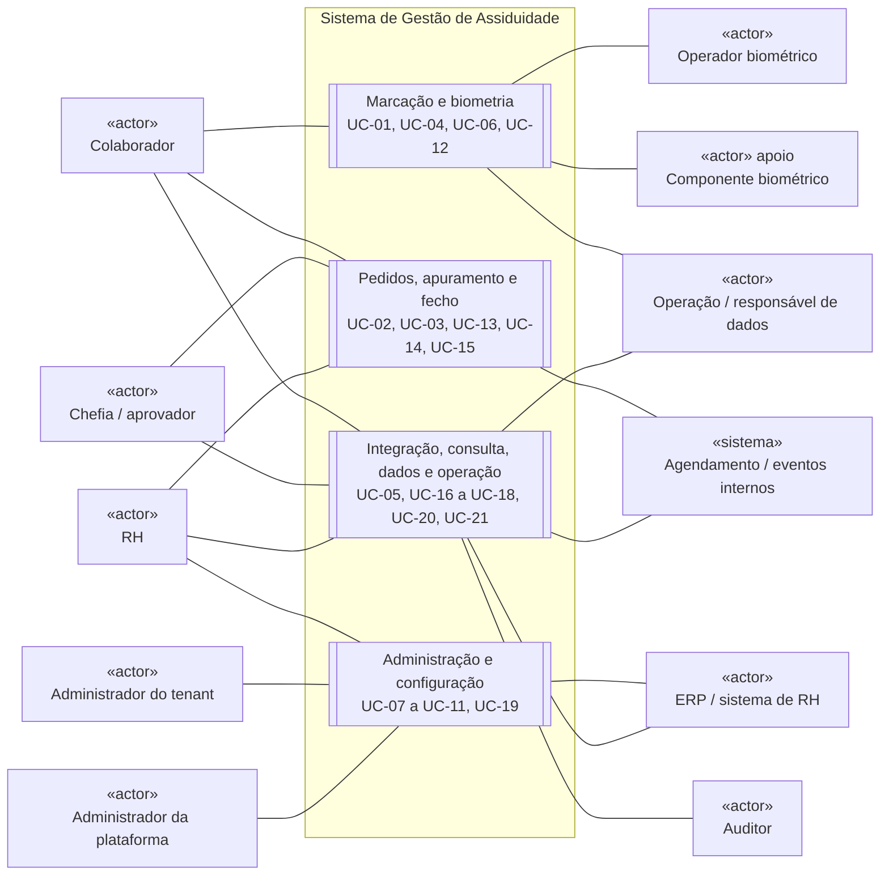

O actor «sistema» representa execuções iniciadas por agendamento ou eventos internos (UC-05, UC-13, UC-18). Não é um utilizador com permissões ilimitadas: cada execução aplica o tenant, o âmbito e as permissões definidos para a tarefa.

### 4.2. DG-UC-02 — Marcação e biometria

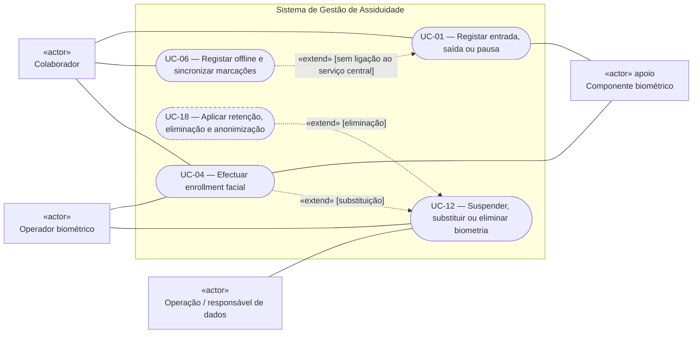

O Colaborador participa no UC-04 como actor de apoio. QR Code, NFC, impressão digital e localização são variantes do UC-01 dependentes de DF-01 e não constituem casos de uso separados. Falha de identificação encaminha para alternativa autorizada ou pedido assistido dentro do próprio UC-01. Casos com contorno tracejado pertencem a outro pacote.

### 4.3. DG-UC-03 — Pedidos, apuramento e fecho

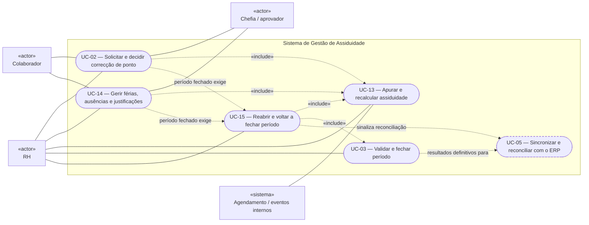

As inclusões de UC-13 correspondem ao passo de aplicação após aprovação (UC-02 passo 6, UC-14 passo 5) e ao recálculo na reabertura (UC-15 passo 4). A rejeição de um pedido é um fluxo alternativo e não executa UC-13.

### 4.4. DG-UC-04 — Administração e configuração

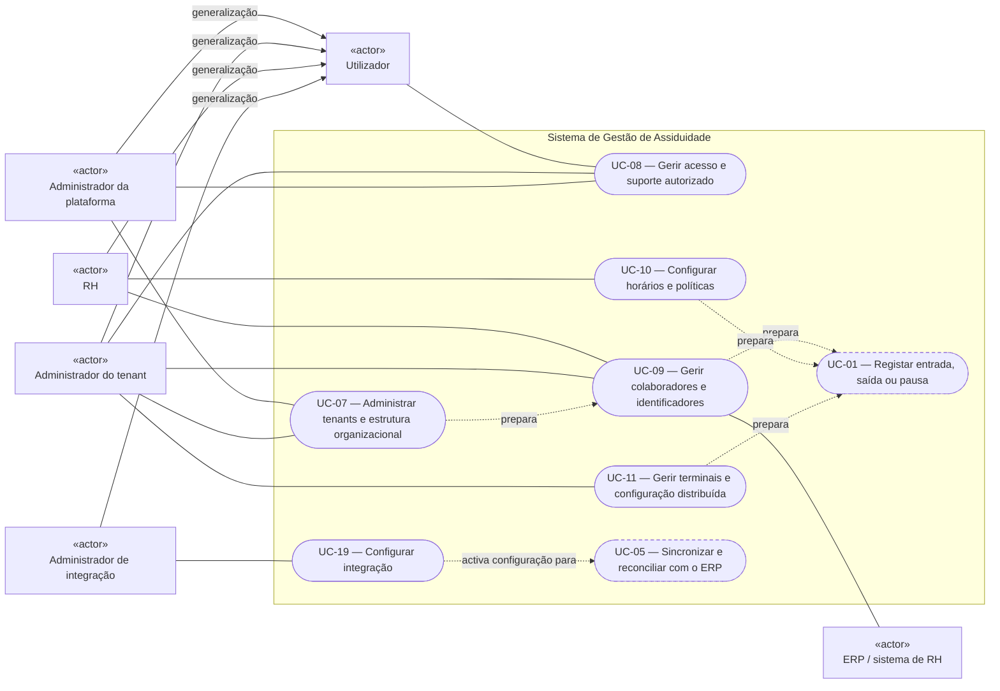

«Utilizador» generaliza qualquer actor humano autenticado; os restantes actores humanos do documento de Casos de Uso também o especializam, mas não são repetidos no diagrama. No UC-08, o Administrador da plataforma participa apenas no suporte transversal com finalidade, âmbito e validade explícitos (RF-008). O ERP participa no UC-09 como fonte de referência de dados mestre, conforme DF-06.

### 4.5. DG-UC-05 — Integração, consulta, dados e operação

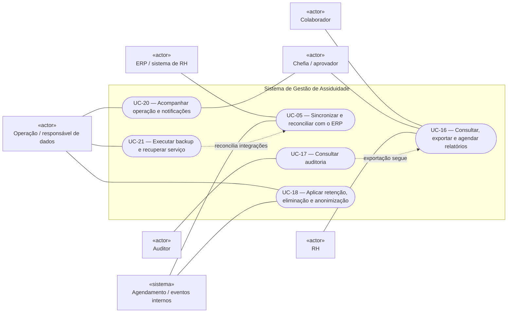

No UC-05, o actor principal é o ERP ou o operador de integração; este último é o actor «Administrador de integração» de DG-UC-04, ou seja, um utilizador com `assiduidade:executar_integracao`. No UC-20, a Chefia / aprovador recebe notificações dentro do seu âmbito quando a capacidade desejável RF-054 estiver activa.

## 5. Diagramas de classes — modelo conceptual

Os quatro diagramas formam um único modelo conceptual dividido por área. Uma classe repetida noutro diagrama sem atributos é a mesma classe. Os atributos correspondem à informação funcional mínima do RF §5; não são colunas nem contratos de API. Campos condicionais devem distinguir “não aplicável” de “indisponível”.

### 5.1. DG-CL-01 — Organização, identidade e acessos

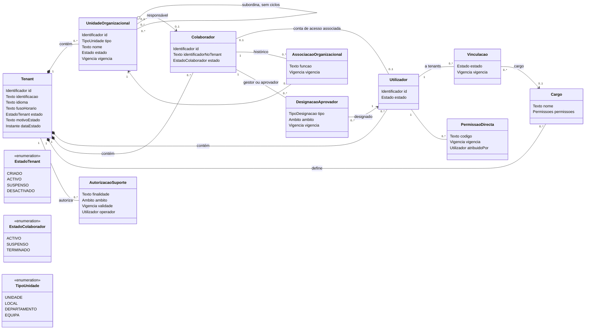

Regras representadas: as permissões efectivas são a união das do `Cargo` da vinculação, das `PermissaoDirecta` e das do tipo de utilizador; o âmbito hierárquico resulta de ser responsável de uma `UnidadeOrganizacional` ou de uma ascendente, ou de designação ou delegação vigente em `DesignacaoAprovador` ([Requisitos Funcionais §3.1](02-Requisitos-Funcionais.md)). Cada objecto pertence a exactamente um tenant (RN-001); a associação a outro tenant e a hierarquia circular são recusadas (RF-004); o cadastro de colaborador é distinto da conta de acesso e não lhe confere permissões (RN-005); a autorização de suporte é temporária e explícita (RF-008). `DesignacaoAprovador` suporta delegação e escalonamento com âmbito e validade (RN-032); as regras de delegação dependem de DF-02 e PN-08.

### 5.2. DG-CL-02 — Terminais, marcações e biometria

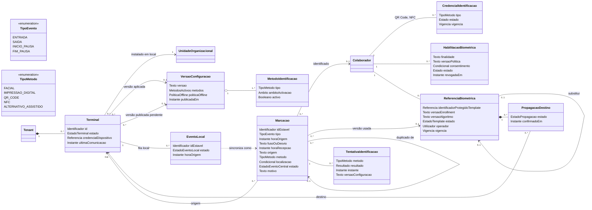

`Marcacao` sem colaborador identificado representa a excepção de identidade controlada de RN-008 e não conta como presença até resolução autorizada. `ReferenciaBiometrica` guarda apenas um identificador protegido do template; o template e as imagens não fazem parte do histórico comum nem de relatórios (RF-037, RN-046). A localização é condicional e recolhida só no momento da marcação quando a política o exigir (RF-031). A classe `EventoLocal` existe apenas no terminal; `Marcacao` é o evento central. Os estados usados aqui estão em DG-ES-01, DG-ES-02 e DG-ES-06.

### 5.3. DG-CL-03 — Horários, apuramento, pedidos e fecho

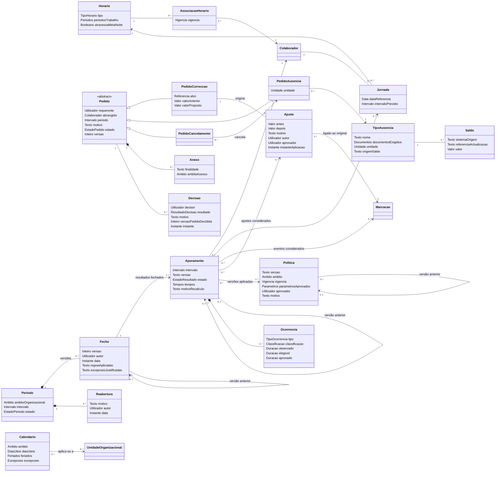

Um `Ajuste` nunca substitui a `Marcacao` original (RN-033, RN-034); um novo cálculo cria nova versão de `Apuramento` sem alterar as anteriores (RN-024). `Ocorrencia` separa valores observados, elegíveis e aprovados (RN-023, RF-040). O `Saldo` indica sempre o sistema de origem e a referência de actualização (RF-041); a fonte de referência depende de PN-07 e DF-06. A associação de `Ajuste` a `Marcacao` representa o caso mais comum; ajustes de resultado apontam para o `Apuramento` afectado, a detalhar no Modelo de Dados. Os estados de `Pedido`, `PedidoCancelamento` e `Periodo` estão em DG-ES-03 a DG-ES-05.

### 5.4. DG-CL-04 — Integração, auditoria, notificações e ciclo de vida

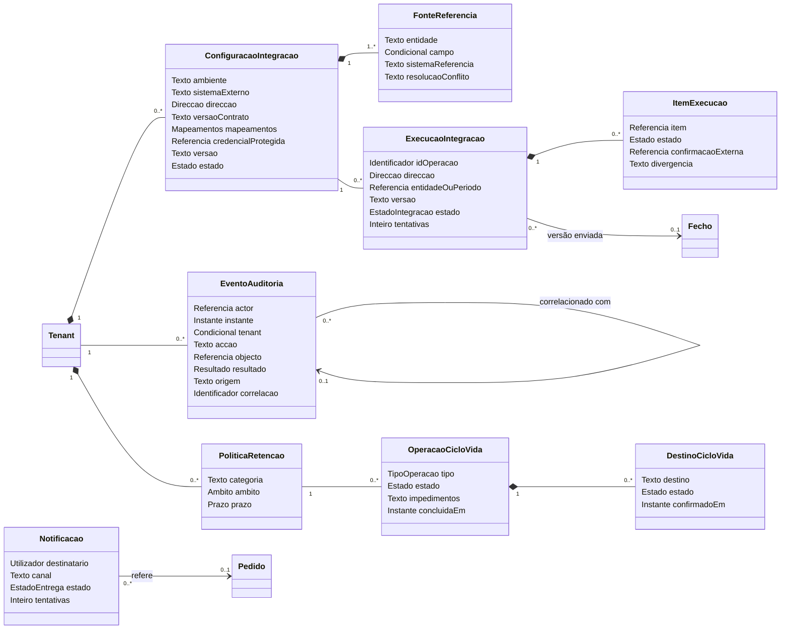

A repetição de uma `ExecucaoIntegracao` mantém o `idOperacao`; uma nova versão de resultados exige nova referência e reconciliação (RF §6, RN-042). `EventoAuditoria` não contém segredos nem templates (RF-060) e é protegido contra alteração (RNF-025). `EventoAuditoria` pode referir qualquer objecto do modelo; essas ligações não são desenhadas para não sobrecarregar o diagrama. `OperacaoCicloVida` regista a evidência de conclusão sem conservar o conteúdo eliminado (RF-062).

## 6. Diagramas de sequência

Os participantes são componentes lógicos de DG-CP-01 e DG-CP-02. A seta contínua indica pedido, a tracejada indica resposta e a de ponta aberta indica mensagem assíncrona. Todas as mensagens para a plataforma central passam pela revalidação de tenant, permissão, âmbito e objecto, que só é desenhada quando altera o fluxo.

### 6.1. DG-SQ-01 — Marcação online com reconhecimento facial (UC-01)

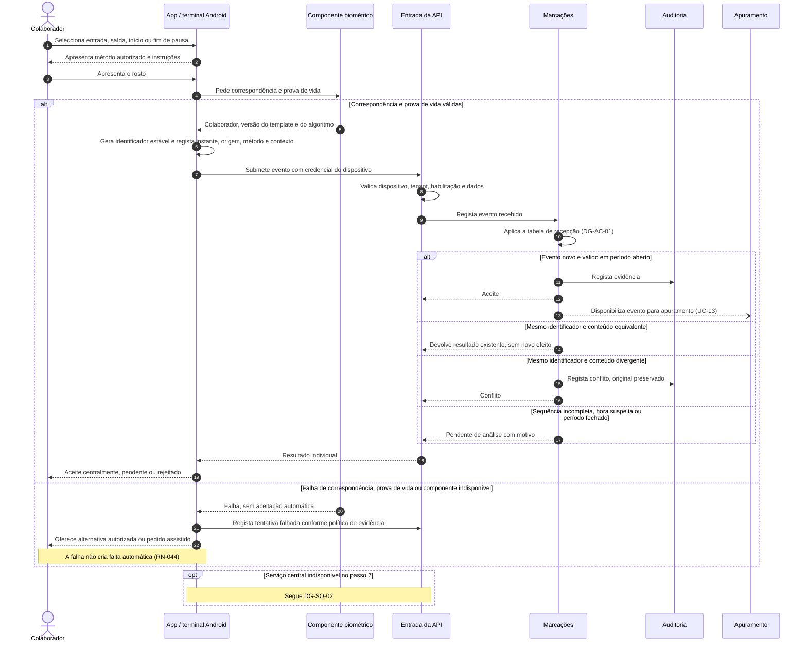

O local de execução do componente biométrico (terminal, plataforma central ou serviço externo) depende de DF-04; a interacção lógica mantém-se em qualquer das opções. QR Code, NFC e impressão digital substituem os passos 3 a 5 pelo método activado. O limite de tentativas antes de oferecer a alternativa é parâmetro de PN-11.

### 6.2. DG-SQ-02 — Marcação offline e sincronização (UC-06)

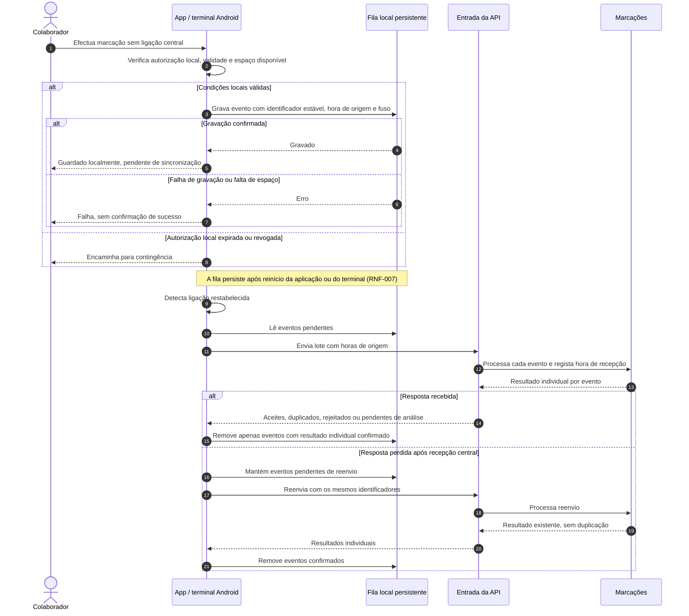

Eventos capturados antes de suspensão, revogação ou expiração e recebidos depois seguem RN-015 e, enquanto DF-03 não estiver aprovada, ficam pendentes de análise. Relógio suspeito e evento de período fechado seguem a mesma via (DG-AC-01).

### 6.3. DG-SQ-03 — Solicitação e decisão de correcção (UC-02)

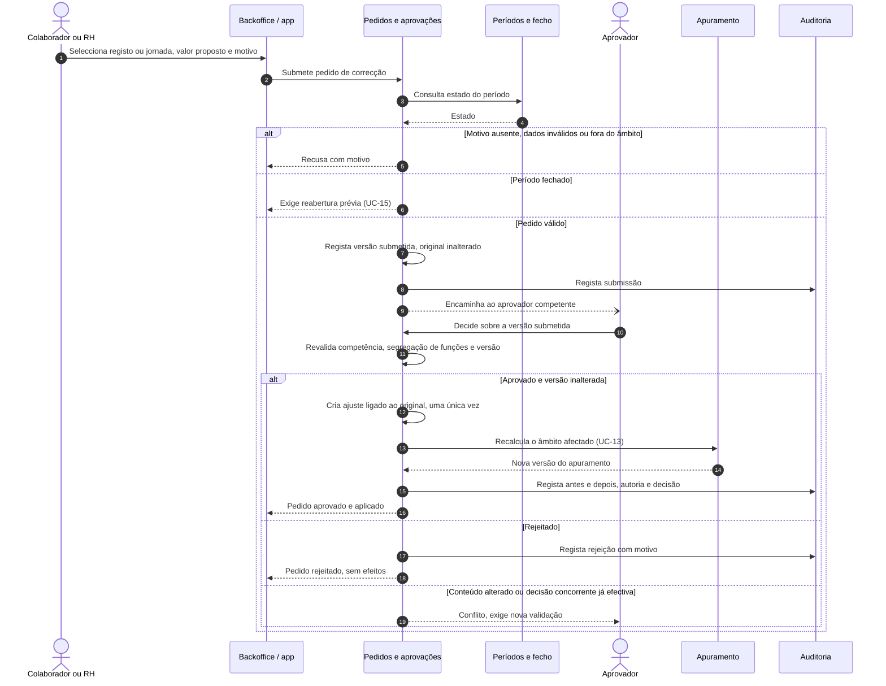

Auto-aprovação permanece bloqueada enquanto não houver política explícita (RN-031). Delegação e escalonamento seguem RN-032. A inclusão de marcação em falta usa o mesmo fluxo e fica identificada como ajuste (RN-033).

### 6.4. DG-SQ-04 — Enrollment facial (UC-04)

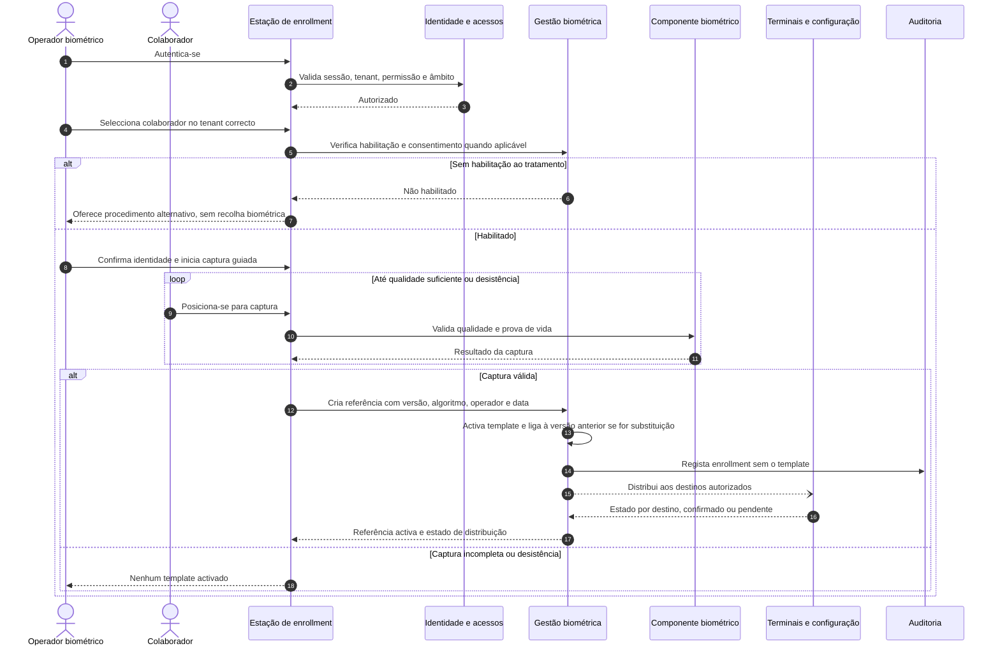

### 6.5. DG-SQ-05 — Fecho de período e envio ao ERP (UC-03, UC-05)

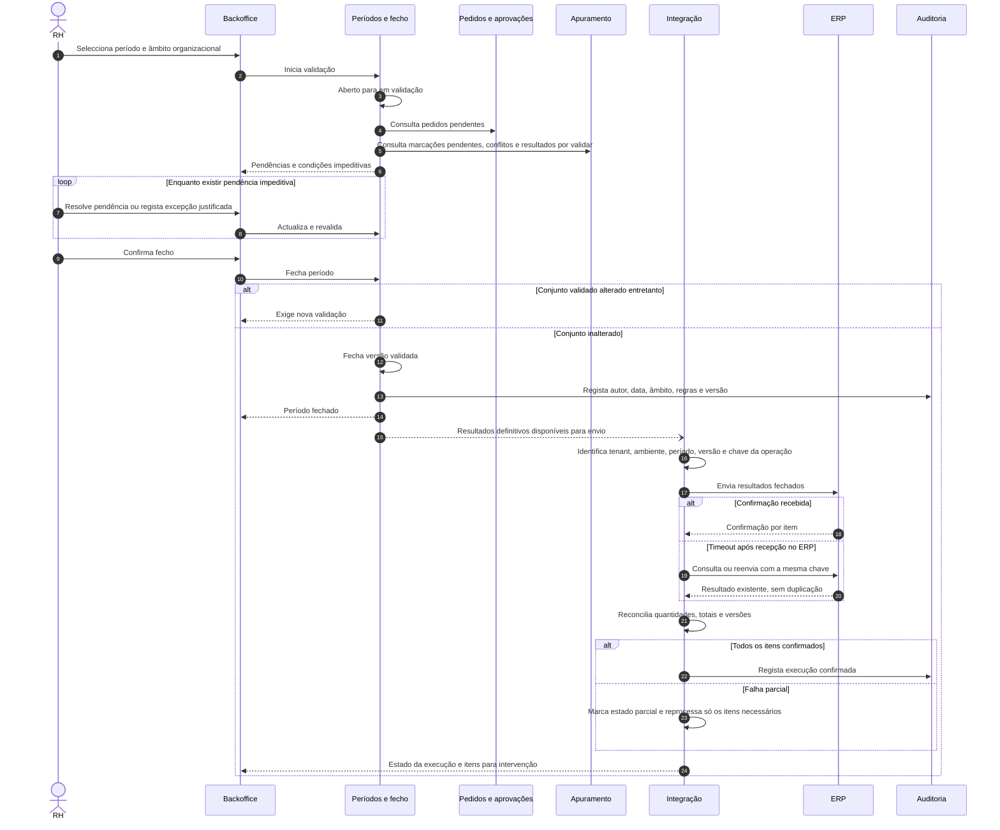

O envio pode ser imediato ou agendado, conforme contrato de UC-19. Período aberto nunca é enviado como definitivo (RN-041). Transferência técnica não equivale a confirmação de aplicação no ERP.

### 6.6. DG-SQ-06 — Reabertura, novo fecho e reconciliação (UC-15)

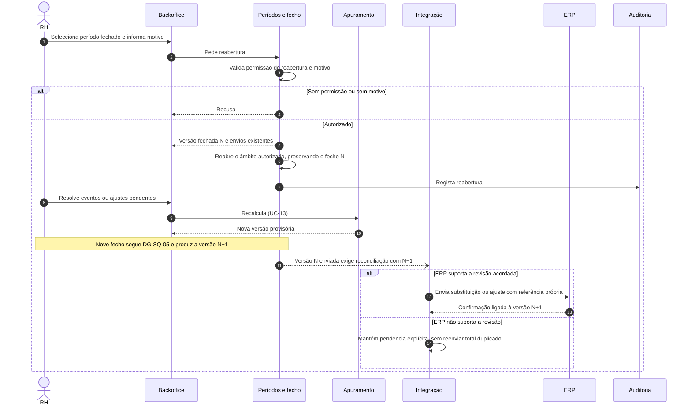

### 6.7. DG-SQ-07 — Suspensão ou eliminação de template e propagação (UC-12)

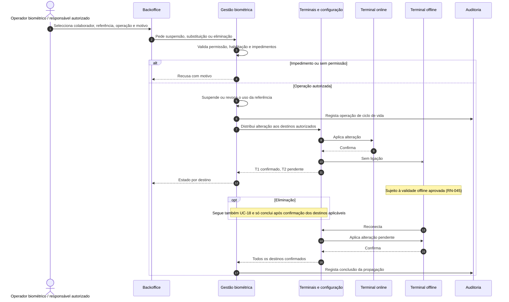

A substituição executa UC-04 com nova versão (DG-SQ-04). Impedimento de eliminação não é confundido com autorização de utilização (RN-047).

## 7. Diagramas de actividades

### 7.1. DG-AC-01 — Recepção e classificação de eventos (RN §6.1)

A ordem das decisões é normativa: a primeira condição aplicável determina o tratamento inicial.

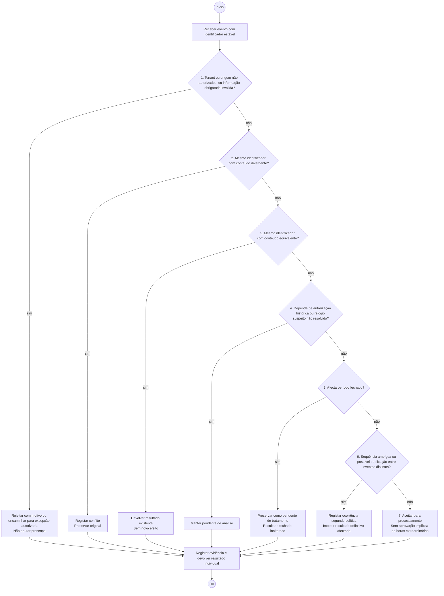

### 7.2. DG-AC-02 — Apuramento de assiduidade (RN §5.1, UC-13)

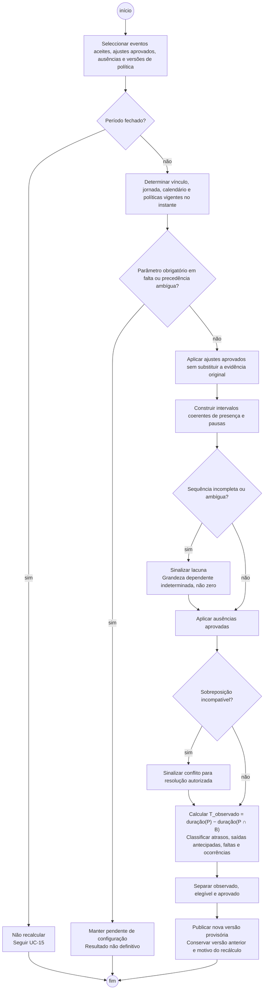

A conclusão de falta exige verificar calendário, vínculo, ausências aprovadas e marcações pendentes; falha técnica ou biométrica isolada não prova ausência (RN-022). Repetir o cálculo com as mesmas entradas produz o mesmo resultado sem acumular horas nem movimentar saldos novamente (RN-024). As lacunas e conflitos sinalizados impedem que o resultado afectado seja apresentado como definitivo.

### 7.3. DG-AC-03 — Pedido de férias, ausência ou justificação (UC-14)

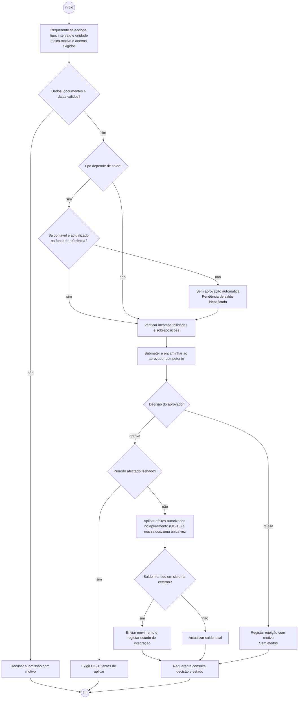

Justificação aprovada não implica automaticamente tempo remunerado (RN-029). Reserva, débito e saldo negativo dependem de PN-07. O cancelamento de um pedido aprovado (RF-045, desejável) segue DG-ES-04.

### 7.4. DG-AC-04 — Retenção, eliminação e anonimização (UC-18)

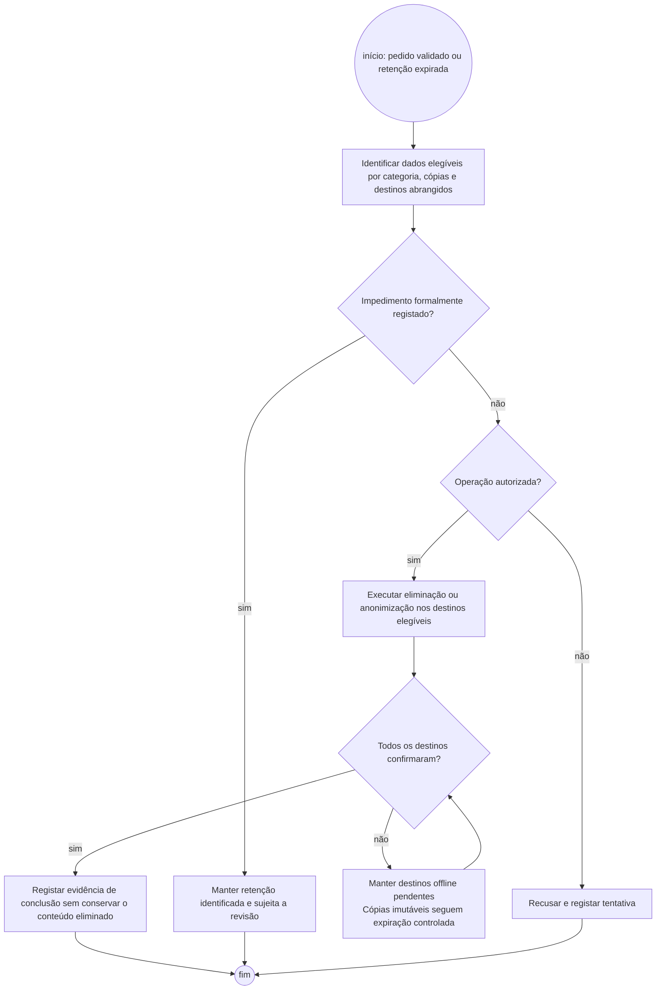

O ciclo de pendência não tem limite desenhado porque o prazo de expiração de cópias e terminais depende de PN-12 e DF-08; enquanto houver destinos pendentes, a eliminação não é apresentada como concluída.

### 7.5. DG-AC-05 — Backup e recuperação de serviço (UC-21)

```mermaid
flowchart TD
    I(("início: rotina, exercício ou incidente")) --> A1["Executar ou verificar cópia<br/>Registar resultado e ponto recuperável"]
    A1 --> D0{"Recuperação necessária?"}
    D0 -->|não| F(("fim"))
    D0 -->|sim| A2["Seleccionar ponto de recuperação e preparar ambiente controlado"]
    A2 --> D1{"Cópia válida e chaves disponíveis?"}
    D1 -->|não| X1["Activar contingência<br/>Não declarar recuperação"]
    D1 -->|sim| A3["Restaurar dados e dependências pela ordem do plano"]
    A3 --> A4["Reaplicar revogações, eliminações e alterações de acesso posteriores à cópia"]
    A4 --> A5["Reconciliar eventos, fechos, auditoria e integrações"]
    A5 --> A6["Validar isolamento entre tenants e serviço<br/>Medir RPO e RTO"]
    A6 --> D2{"Divergências por resolver?"}
    D2 -->|sim| X2["Não declarar recuperação integral<br/>Documentar limites de perda"]
    D2 -->|não| A7["Autorizar retoma segundo o plano"]
    A7 --> F
    X1 --> F
    X2 --> F
```

A reaplicação (passo A4) ocorre sempre antes da retoma, para não reactivar dados eliminados ou acessos revogados (RN-048). RPO e RTO por classe dependem de DN-07.

## 8. Diagramas de estados

DG-ES-01 a DG-ES-07 transcrevem as transições do RF §6. DG-ES-08 e DG-ES-09 são derivados de RF-001, RF-009, RF-019 e RF-020 e estão assinalados para validação. Transições não desenhadas não são permitidas.

### 8.1. DG-ES-01 — Evento local (terminal)

```mermaid
stateDiagram-v2
    [*] --> Pendente : gravação local confirmada
    Pendente --> Enviado : ligação disponível
    Enviado --> Confirmado : resultado individual recebido
    Enviado --> PendenteReenvio : sem resposta
    PendenteReenvio --> Enviado : reenvio com o mesmo identificador
    Confirmado --> [*] : removido da fila

    state "Pendente de reenvio" as PendenteReenvio
    note right of Confirmado
        Resultado individual reconciliado,
        que pode ser aceite, duplicado,
        rejeitado ou pendente de análise central.
        Envio não equivale a aceitação.
    end note
```

### 8.2. DG-ES-02 — Evento central

```mermaid
stateDiagram-v2
    [*] --> Recebido
    Recebido --> Aceite : contexto válido em período aberto
    Recebido --> Duplicado : mesmo identificador, conteúdo equivalente
    Recebido --> Rejeitado : origem ou dados inválidos, com motivo
    Recebido --> PendenteAnalise : conflito, autorização histórica, relógio suspeito ou período fechado
    PendenteAnalise --> Aceite : decisão autorizada
    PendenteAnalise --> Rejeitado : decisão autorizada, com motivo

    state "Pendente de análise" as PendenteAnalise
    note right of Duplicado
        Referencia o evento efectivo.
        O evento original é sempre preservado.
    end note
```

### 8.3. DG-ES-03 — Pedido

```mermaid
stateDiagram-v2
    [*] --> Rascunho
    Rascunho --> Submetido : submissão com dados válidos
    Submetido --> EmAprovacao : encaminhado ao aprovador competente
    EmAprovacao --> Aprovado : decisão com competência sobre a versão submetida
    EmAprovacao --> Rejeitado : decisão com motivo
    EmAprovacao --> Submetido : conteúdo alterado, nova versão (derivado)
    Aprovado --> Cancelado : cancelamento aprovado (DG-ES-04)
    Rejeitado --> [*]
    Cancelado --> [*]

    state "Em aprovação" as EmAprovacao
```

A transição “conteúdo alterado” interpreta o controlo do RF §6 (“alterar conteúdo submetido exige nova versão e nova validação”); ver secção 12.

### 8.4. DG-ES-04 — Cancelamento

```mermaid
stateDiagram-v2
    [*] --> Solicitado
    Solicitado --> Aprovado : decisão competente
    Solicitado --> Rejeitado : decisão com motivo
    Aprovado --> [*] : pedido original passa a cancelado e efeitos revertidos uma vez
    Rejeitado --> [*]
    note right of Aprovado
        Se afectar período fechado,
        exige reabertura prévia (RN-030).
    end note
```

### 8.5. DG-ES-05 — Período

```mermaid
stateDiagram-v2
    [*] --> Aberto
    Aberto --> EmValidacao : início da validação
    EmValidacao --> Aberto : validação interrompida
    EmValidacao --> Fechado : fecho confirmado sem pendências impeditivas
    Fechado --> Reaberto : permissão e motivo
    Reaberto --> EmValidacao : recálculo concluído

    state "Em validação" as EmValidacao
    note right of Fechado
        Cada fecho cria uma versão nova.
        Resultados bloqueados para qualquer origem (RN-038).
    end note
```

### 8.6. DG-ES-06 — Template biométrico

```mermaid
stateDiagram-v2
    [*] --> EmPreparacao : enrollment iniciado
    EmPreparacao --> Activo : captura válida
    Activo --> Suspenso : suspensão ou revogação de uso
    Activo --> Substituido : novo enrollment activado
    Activo --> EliminacaoPendente : eliminação autorizada
    Suspenso --> EliminacaoPendente : eliminação autorizada
    Substituido --> EliminacaoPendente : eliminação autorizada
    EliminacaoPendente --> Eliminado : todos os destinos aplicáveis confirmaram
    Eliminado --> [*]

    state "Em preparação" as EmPreparacao
    state "Substituído" as Substituido
    state "Eliminação pendente" as EliminacaoPendente
```

Captura incompleta nunca passa a `Activo` (RN-043). A propagação de cada mudança de estado aos terminais é acompanhada por destino em `PropagacaoDestino` (DG-CL-02).

### 8.7. DG-ES-07 — Execução de integração

```mermaid
stateDiagram-v2
    [*] --> Pendente
    Pendente --> EmProcessamento
    EmProcessamento --> Confirmada : todos os itens confirmados
    EmProcessamento --> Parcial : parte dos itens falhou
    EmProcessamento --> Falhada : falha da operação
    Parcial --> EmReprocessamento : reprocessar itens necessários
    Falhada --> EmReprocessamento : reprocessar com a mesma identidade
    EmReprocessamento --> Confirmada
    EmReprocessamento --> Parcial
    EmReprocessamento --> Falhada
    Confirmada --> [*]

    state "Em processamento" as EmProcessamento
    state "Parcialmente concluída" as Parcial
    state "Em reprocessamento" as EmReprocessamento
```

### 8.8. DG-ES-08 — Terminal e configuração distribuída (derivado)

```mermaid
stateDiagram-v2
    [*] --> Registado : registo no tenant e local
    Registado --> Activo : credencial e métodos habilitados
    Activo --> Revogado : revogação central
    Registado --> Revogado : revogação central
    Revogado --> [*]

    state Activo {
        state "Configuração aplicada" as ConfigAplicada
        state "Configuração pendente" as ConfigPendente
        state "Falha, versão anterior mantida" as ConfigFalhada
        [*] --> ConfigAplicada
        ConfigAplicada --> ConfigPendente : nova versão publicada
        ConfigPendente --> ConfigAplicada : terminal confirma a versão
        ConfigPendente --> ConfigFalhada : falha de aplicação
        ConfigFalhada --> ConfigPendente : nova tentativa ou nova versão
    }
```

Terminal revogado não cria nova marcação aceite automaticamente; eventos já capturados seguem RN-015. Terminal offline permanece em `Configuração pendente`, sem confirmação fictícia (UC-11).

### 8.9. DG-ES-09 — Tenant e colaborador (derivado)

```mermaid
stateDiagram-v2
    state Tenant {
        state "Activo" as TActivo
        state "Suspenso" as TSuspenso
        [*] --> Criado
        Criado --> TActivo : activação
        TActivo --> TSuspenso : suspensão com motivo
        TSuspenso --> TActivo : reactivação com motivo
        TActivo --> Desactivado : desactivação com motivo
        TSuspenso --> Desactivado : desactivação com motivo
    }
    state Colaborador {
        state "Activo" as CActivo
        state "Suspenso" as CSuspenso
        [*] --> CActivo
        CActivo --> CSuspenso : suspensão
        CSuspenso --> CActivo : fim da suspensão
        CActivo --> Terminado : término do vínculo
        CSuspenso --> Terminado : término do vínculo
    }
```

Nenhum dos estados elimina o histórico (RF §6). Tenant suspenso não admite novas operações de negócio (RF-001); colaborador inactivo não gera marcação aceite automática (RF-021).

## 9. Diagramas de componentes

### 9.1. DG-CP-01 — Plataforma central e fronteiras externas

```mermaid
flowchart TB
    subgraph CAN["Canais"]
        direction LR
        BOW["«componente»<br/>Backoffice web"]
        AND["«componente»<br/>App Android / modo terminal<br/>(DG-CP-02)"]
    end

    subgraph PC["Plataforma central"]
        GW["«componente»<br/>Entrada da API<br/>autenticação, tenant, limites"]
        IDA["«componente»<br/>Identidade e acessos"]
        subgraph DOM["Serviços de domínio"]
            direction LR
            ORG["«componente»<br/>Organização e colaboradores"]
            POL["«componente»<br/>Horários e políticas"]
            TER["«componente»<br/>Terminais e configuração"]
            MAR["«componente»<br/>Marcações"]
            BIM["«componente»<br/>Gestão biométrica"]
            PED["«componente»<br/>Pedidos e aprovações"]
            APU["«componente»<br/>Apuramento"]
            PER["«componente»<br/>Períodos e fecho"]
            REL["«componente»<br/>Relatórios e exportação"]
            INT["«componente»<br/>Integração"]
            CIC["«componente»<br/>Retenção e ciclo de vida"]
        end
        subgraph TRV["Serviços transversais"]
            direction LR
            AUD["«componente»<br/>Auditoria"]
            NOT["«componente»<br/>Notificações"]
            OBS["«componente»<br/>Observabilidade"]
        end
    end

    subgraph EXT["Sistemas externos"]
        direction LR
        IDP["«externo»<br/>Serviço de identidade"]
        SBI["«externo»<br/>Serviço biométrico<br/>(se adoptado, DF-04)"]
        ERP["«externo»<br/>ERP / folha salarial"]
        SRH["«externo»<br/>Sistema de RH"]
        SNO["«externo»<br/>Serviço de notificações"]
    end

    BOW --> GW
    AND --> GW
    GW --> IDA
    GW -->|"pedido autorizado"| DOM
    MAR --> APU
    PED --> APU
    POL --> APU
    PER --> APU
    PER --> INT
    BIM --> TER
    CIC --> BIM
    INT --> ORG
    DOM -.->|"evidência de operações críticas"| AUD
    DOM -.->|"métricas e estado"| OBS
    PED --> NOT
    OBS --> NOT
    IDA <--> IDP
    BIM <--> SBI
    INT <--> ERP
    INT <--> SRH
    NOT --> SNO
```

| Componente | Responsabilidade | RF principais |
| --- | --- | --- |
| Entrada da API | Autenticar pedidos e dispositivos, determinar tenant, aplicar limites de abuso e correlação | RF-002, RF-006, RF-019; RNF-005, RNF-018 |
| Identidade e acessos | Sessões, papéis, âmbitos, suporte autorizado; revalidação no serviço executor | RF-006 a RF-008 |
| Organização e colaboradores | Tenants, estrutura, colaboradores, identificadores, importação | RF-001 a RF-005, RF-009 a RF-013 |
| Horários e políticas | Calendários, horários, políticas versionadas, simulação | RF-014 a RF-018 |
| Terminais e configuração | Registo, credenciais de dispositivo, distribuição e confirmação de versões | RF-019, RF-020 |
| Marcações | Recepção, idempotência, tabela de decisão, pendências | RF-021 a RF-031 |
| Gestão biométrica | Habilitação, enrollment, referências, limiar, propagação | RF-032 a RF-037, RF-061 |
| Apuramento | Jornadas, intervalos, tempos, ocorrências e versões | RF-038 a RF-040, RF-044 |
| Pedidos e aprovações | Correcções, ausências, cancelamentos, decisões e ajustes | RF-041 a RF-047 |
| Períodos e fecho | Validação, fecho, reabertura e versões | RF-048 a RF-050 |
| Relatórios e exportação | Consultas, relatórios, exportação e agendamento | RF-051 a RF-053, RF-055 |
| Integração | Conexões, contratos, execuções, reprocessamento e reconciliação | RF-056 a RF-059 |
| Notificações | Envio, falha e reenvio controlado | RF-054, RF-064 |
| Retenção e ciclo de vida | Retenção, eliminação, anonimização e acompanhamento de destinos | RF-062 |
| Auditoria | Evidência protegida e consulta | RF-060; RNF-025, RNF-026 |
| Observabilidade | Saúde, filas, terminais, integrações e alertas | RF-063, RF-064; RNF-027, RNF-028 |

As setas a partir dos subgrafos aplicam-se a todos os componentes neles contidos; dentro dos serviços de domínio só são desenhadas as dependências mais significativas. A Retenção e ciclo de vida actua também sobre terminais, ficheiros e cópias, através dos componentes que os gerem. O isolamento entre tenants aplica-se a todos os componentes, incluindo caches, ficheiros, filas e tarefas de fundo (RNF-013). A divisão em componentes lógicos não impõe a divisão em serviços implantados separadamente, que é decisão da Arquitectura.

### 9.2. DG-CP-02 — Aplicação Android / modo terminal

```mermaid
flowchart LR
    subgraph APP["App Android / modo terminal"]
        UI["«componente»<br/>Interface de marcação<br/>estados aceite, pendente, falha"]
        IDL["«componente»<br/>Identificação local<br/>facial, QR Code, NFC, digital"]
        CTX["«componente»<br/>Contexto da marcação<br/>instante, fuso, localização se exigida"]
        FL["«componente»<br/>Fila local persistente"]
        ARM["«componente»<br/>Armazenamento local protegido<br/>autorizações, templates distribuídos"]
        SYN["«componente»<br/>Sincronização<br/>reenvio e reconciliação"]
        CFGL["«componente»<br/>Configuração aplicada"]
    end

    PER1["«dispositivo»<br/>Câmara, leitor NFC,<br/>leitor digital, GPS"]
    GW["«componente»<br/>Entrada da API"]

    UI --> IDL
    IDL --> PER1
    IDL --> ARM
    UI --> CTX
    CTX --> PER1
    UI --> FL
    FL --> SYN
    SYN <--> GW
    CFGL <--> GW
    CFGL --> IDL
    CFGL --> ARM
```

A presença de templates no terminal e a execução local do reconhecimento dependem de DF-04. A validade das autorizações locais e a capacidade da fila dependem de DF-03 e DN-03. A localização é recolhida apenas no momento da marcação quando a política a exigir (RF-031).

## 10. DG-DP-01 — Diagrama de deployment

O diagrama é lógico. Número de instâncias, zonas, réplicas, fornecedores e regiões não estão decididos e dependem de DN-02, DN-04 e DN-07.

```mermaid
flowchart TB
    subgraph CLI["«nó» Instalações do cliente"]
        DA["«dispositivo» Terminal Android<br/>app em modo terminal<br/>fila local, armazenamento protegido"]
        DB["«dispositivo» Telemóvel Android<br/>app do colaborador, se aprovada"]
        NAV["«dispositivo» Posto de trabalho<br/>navegador, backoffice"]
    end

    subgraph PLT["«ambiente» Produção da plataforma"]
        subgraph ENT["«nó» Zona de entrada"]
            LB["Terminação TLS e encaminhamento"]
        end
        subgraph APPN["«nó» Nós de aplicação"]
            API["«artefacto» API e componentes de DG-CP-01"]
            WRK["«artefacto» Processamento assíncrono<br/>apuramento, integração, notificações,<br/>relatórios agendados, retenção"]
        end
        subgraph DAT["«nó» Nós de dados"]
            BDT[("Base transaccional")]
            FIL[("Fila de mensagens")]
            OBJ[("Armazenamento de ficheiros<br/>anexos e exportações")]
            BIOD[("Armazenamento biométrico protegido")]
            AUDD[("Armazenamento de auditoria protegido")]
        end
        SEC["«nó» Gestão de segredos e chaves"]
        MON["«nó» Observabilidade<br/>métricas, logs, alertas"]
    end

    BKP[("«nó» Cópias de segurança<br/>localização separada")]
    EXTS["«nó» Sistemas externos<br/>ERP, RH, identidade, notificações,<br/>serviço biométrico se adoptado"]
    NP["«ambiente» Desenvolvimento e teste<br/>segregados, dados sintéticos"]

    DA -->|"HTTPS"| LB
    DB -->|"HTTPS"| LB
    NAV -->|"HTTPS"| LB
    LB --> API
    API --> BDT
    API --> FIL
    API --> OBJ
    API --> BIOD
    API --> AUDD
    FIL --> WRK
    WRK --> BDT
    WRK --> AUDD
    API -.-> SEC
    WRK -.-> SEC
    WRK <-->|"canal cifrado"| EXTS
    API -.-> MON
    WRK -.-> MON
    DAT -.->|"cópia cifrada"| BKP
```

| Nó / elemento | Requisitos atendidos | Decisão pendente |
| --- | --- | --- |
| Terminal / telemóvel Android | RNF-007, RNF-008, RNF-016, RNF-032 | DN-03, DN-08; DF-01 |
| Zona de entrada | RNF-005, RNF-015, RNF-018 | DN-04 |
| Nós de aplicação e processamento assíncrono | RNF-001 a RNF-004, RNF-006, RNF-011 | DN-01, DN-02 |
| Nós de dados | RNF-009, RNF-013, RNF-016, RNF-021, RNF-025 | DN-04, DN-06, DN-07 |
| Gestão de segredos e chaves | RNF-016, RNF-017 | DN-04 |
| Observabilidade | RNF-027, RNF-028 | DN-09 |
| Cópias de segurança | RNF-021, RNF-029 | DN-06, DN-07 |
| Ambientes não produtivos | RNF-022, RNF-035 | DN-10 |

A separação entre armazenamento biométrico, auditoria e dados transaccionais é lógica: representa controlos de acesso e ciclos de vida distintos (RNF-016, RNF-021, RNF-025), não necessariamente servidores diferentes. O acesso às chaves é separado do acesso corrente aos dados (RNF-016). As cópias de segurança herdam o isolamento por tenant e a reaplicação de eliminações no restauro (RN-048).

## 11. Rastreabilidade

| Diagrama | Casos de uso | Requisitos funcionais | Regras / RNF |
| --- | --- | --- | --- |
| DG-UC-01 a DG-UC-05 | UC-01 a UC-21 | RF-001 a RF-065 | — |
| DG-CL-01 | UC-07 a UC-09 | RF-001 a RF-013 | RN-001 a RN-005, RN-032 |
| DG-CL-02 | UC-01, UC-04, UC-06, UC-11, UC-12 | RF-019 a RF-037, RF-061 | RN-008 a RN-015, RN-043 a RN-046 |
| DG-CL-03 | UC-02, UC-03, UC-10, UC-13 a UC-15 | RF-014 a RF-018, RF-038 a RF-050 | RN-006, RN-007, RN-017 a RN-039 |
| DG-CL-04 | UC-05, UC-17 a UC-20 | RF-054, RF-056 a RF-062 | RN-040 a RN-042, RN-047 |
| DG-SQ-01 | UC-01 | RF-021 a RF-024, RF-027, RF-034, RF-037 | RN-008 a RN-012, RN-044; RNF-001 |
| DG-SQ-02 | UC-06 | RF-022, RF-025, RF-026 | RN-013 a RN-016; RNF-007 a RNF-009 |
| DG-SQ-03 | UC-02 | RF-046, RF-047 | RN-031 a RN-035; RNF-010 |
| DG-SQ-04 | UC-04 | RF-032, RF-033, RF-035, RF-061 | RN-043, RN-045 |
| DG-SQ-05 | UC-03, UC-05 | RF-048, RF-049, RF-058, RF-059 | RN-037, RN-038, RN-041, RN-042 |
| DG-SQ-06 | UC-15 | RF-050, RF-058, RF-059 | RN-039, RN-042 |
| DG-SQ-07 | UC-12 | RF-036, RF-061 | RN-045, RN-047 |
| DG-AC-01 | UC-01, UC-06 | RF-021, RF-023, RF-024, RF-026 | RN §6.1, RN-008 a RN-016 |
| DG-AC-02 | UC-13 | RF-038 a RF-040 | RN §5.1, RN-017 a RN-024 |
| DG-AC-03 | UC-14 | RF-041 a RF-045 | RN-025 a RN-030 |
| DG-AC-04 | UC-18 | RF-062 | RN-047; RNF-021 |
| DG-AC-05 | UC-21 | RF-065 | RN-048; RNF-029 |
| DG-ES-01 a DG-ES-07 | UC-01 a UC-06, UC-12 a UC-15 | RF §6 | RN-010, RN-014, RN-035 a RN-039 |
| DG-ES-08, DG-ES-09 | UC-07, UC-09, UC-11 | RF-001, RF-009, RF-019, RF-020 | RN-004, RN-015 |
| DG-CP-01, DG-CP-02 | Todos | RF-001 a RF-065 | RNF-013 a RNF-018, RNF-025 a RNF-028 |
| DG-DP-01 | UC-20, UC-21 | RF-063 a RF-065 | RNF-004 a RNF-017, RNF-021, RNF-029 |

## 12. Pontos em aberto identificados na modelação

A modelação expôs lacunas nos documentos de origem. Os diagramas adoptam a interpretação indicada, que deve ser confirmada ou corrigida na origem antes da aprovação.

| ID | Constatação | Interpretação adoptada | Documento a actualizar |
| --- | --- | --- | --- |
| DU-01 | UC-05 e UC-19 referem “operador de integração” e “administrador de integração”, que não constam da tabela de actores | Resolvido: actor «Administrador de integração» nos [Casos de Uso §3](05-Casos-de-Uso.md), definido pelas permissões `assiduidade:gerir_integracao` e `executar_integracao` | — |
| DU-02 | RN-010 e RN §6.1 registam “conflito” para o mesmo identificador com conteúdo divergente, mas RF §6 não tem estado de conflito para o evento central | Conflito tratado como `Pendente de análise` com motivo | RF §6 |
| DU-03 | RN-036 refere devolução e desistência de pedidos, sem estados correspondentes em RF §6 | Não desenhados; desistência de pedido aprovado segue cancelamento | RF §6; PN-08 |
| DU-04 | RF §6 exige nova versão ao alterar conteúdo submetido, sem indicar o estado resultante | Transição `Em aprovação → Submetido` marcada como derivada | RF §6 |
| DU-05 | Não está definido se um template suspenso pode voltar a `Activo`, nem o que acontece a um enrollment abandonado | Sem reactivação e sem transição de abandono; nova activação exige novo enrollment | RF §6; DF-08 |
| DU-06 | RF §6 não indica o motivo da transição `Em validação → Aberto` do período | Rotulada como “validação interrompida” | RF §6; PN-09 |
| DU-07 | Estados de tenant, colaborador e terminal não constam de RF §6 | Derivados de RF-001, RF-009, RF-019 e RF-020 (DG-ES-08, DG-ES-09), incluindo reactivação de tenant suspenso | RF §6 |
| DU-08 | O local de execução do reconhecimento facial (terminal, central ou externo) não está decidido | Componente biométrico representado como participante lógico; templates no terminal condicionais | DF-04; Arquitectura (07) |
| DU-09 | Não está definido se existe app do colaborador em telemóvel pessoal, além do modo terminal | Nó “Telemóvel Android” condicionado a aprovação | DF-01; Especificação de Dispositivos (11) |
| DU-10 | O Modelo de Dados terá de decidir como um `Ajuste` aponta para uma marcação ou para um resultado de apuramento | Associação a `Marcacao` desenhada; ajustes de resultado mencionados em texto | Modelo de Dados (09) |

## 13. Aprovação e manutenção

A equipa técnica valida notação, componentes e deployment; RH e negócio validam casos de uso, fluxos de actividade e estados de pedidos e períodos; a equipa ERP valida DG-SQ-05, DG-SQ-06 e DG-ES-07; o responsável de dados e a operação validam DG-SQ-04, DG-SQ-07, DG-AC-04, DG-AC-05 e DG-DP-01. Cada aprovação deve identificar nome, versão e data. Estado de aprovação desta versão: **pendente**.

Alterações a UC, RF §6 ou RN §5 e §6 exigem revisão dos diagramas afectados, identificados na secção 11. Os identificadores DG são estáveis e devem ser usados na Arquitectura, no TDD, no Modelo de Dados e no Plano de Testes. A resolução de cada ponto DU deve actualizar primeiro o documento de origem e depois o diagrama.

## 14. Referências

- [Índice da documentação](README.MD).
- [BRD resumido](01-BRD.md).
- [BRD detalhado](BRD_Sistema_Gestao_Assiduidade.md), secções 6, 11, 13 e 14.
- [Requisitos Funcionais](02-Requisitos-Funcionais.md), secções 5 e 6.
- [Requisitos Não Funcionais](03-Requisitos-Nao-Funcionais.md).
- [Regras de Negócio](04-Regras-de-Negocio.md), secções 5 e 6.
- [Casos de Uso](05-Casos-de-Uso.md).
- [Inventário de endpoints de assiduidade do ERP](../endpoints_assiduidade_erp.md), como referência técnica a reconciliar na Arquitectura e na Especificação de APIs.
