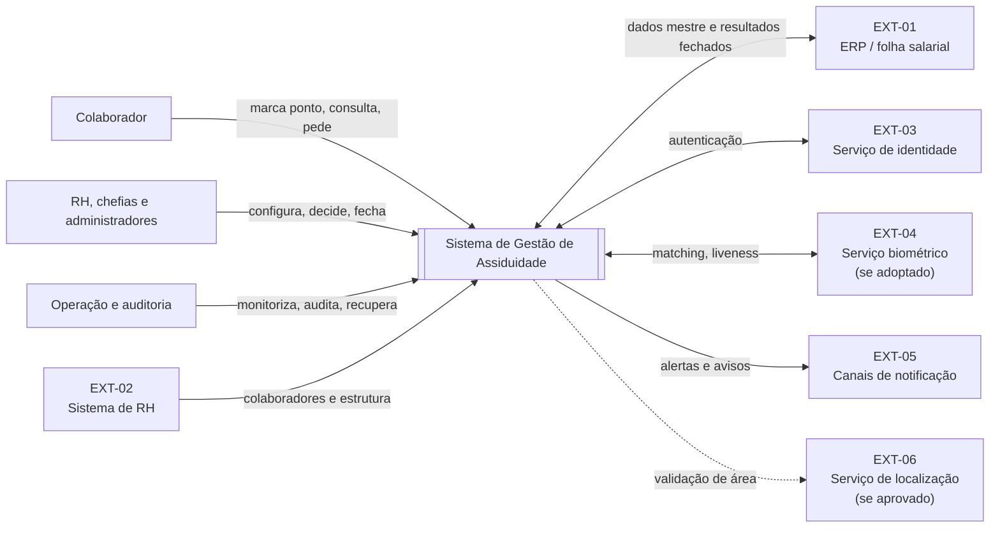
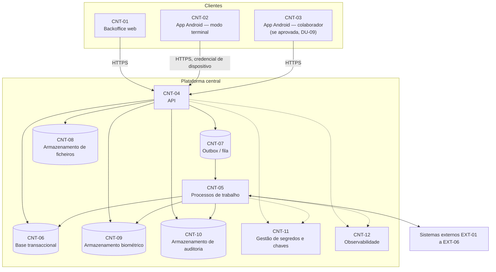
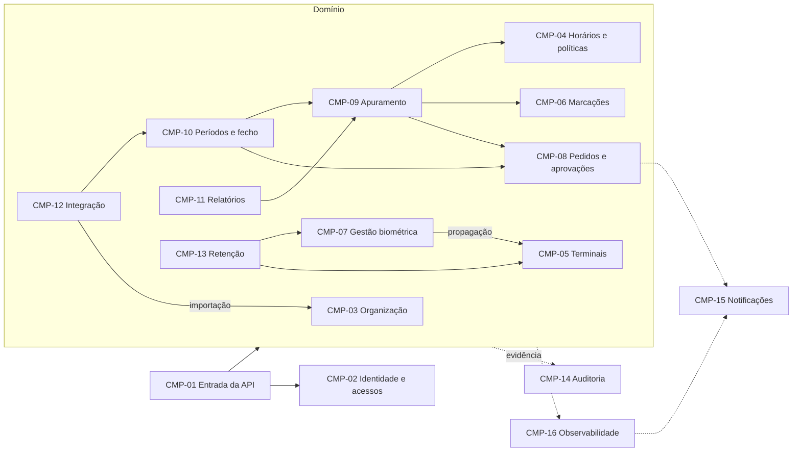

# Arquitectura do Sistema — Sistema de Gestão de Assiduidade

## 1. Controlo do documento

| Campo | Valor |
| --- | --- |
| Referência | ARQ-ASS-001 |
| Versão | 0.2 |
| Data | 25/09/2026 |
| Estado | Rascunho técnico para validação |
| Responsáveis | Equipa técnica, com validação de operação, segurança, equipa ERP e responsável de dados — nomes a designar |
| Base documental | Documentos 01 a 06 e [TDD](08-Documento-de-Design-Tecnico-TDD.md) |

| Versão | Data | Alteração |
| --- | --- | --- |
| 0.1 | 25/09/2026 | Visão de alto nível e lista de componentes |
| 0.2 | 25/09/2026 | Versão detalhada: vistas C4, componentes alinhados com DG-CP-01, eventos de domínio, fronteiras de confiança, classes de recuperação e reconciliação com o ERP existente |

## 2. Objectivo, âmbito e convenções

Este documento descreve a estrutura da solução: o contexto, os contentores implantáveis, os componentes lógicos, a comunicação entre eles e a distribuição física. Os mecanismos transversais (idempotência, tempo, concorrência, outbox, auditoria) estão no [TDD](08-Documento-de-Design-Tecnico-TDD.md) e são referidos pelos seus identificadores MEC.

Convenções:

- As vistas seguem os níveis do modelo C4: **contexto** (§3), **contentores** (§4) e **componentes** (§5).
- **EXT-xx** identifica sistemas externos; **CNT-xx** contentores; **CMP-xx** componentes; **EVD-xx** eventos de domínio; **FC-xx** fronteiras de confiança.
- Os nomes dos componentes são exactamente os de DG-CP-01 do [documento 06](06-Diagramas-UML.md). A divisão em componentes lógicos não impõe serviços implantados separadamente; a forma de implantação é a decisão DT-02.
- Tecnologias concretas só são indicadas quando já decididas; caso contrário, aparece a decisão pendente.

## 3. Vista de contexto

| ID | Sistema externo | Interacção | Direcção | Detalhe | Decisão pendente |
| --- | --- | --- | --- | --- | --- |
| EXT-01 | ERP / folha salarial | Recebe resultados fechados; pode fornecer dados mestre | Bidireccional | [18 §4](18-Integracoes-com-Sistemas-Externos.md) | DF-06 |
| EXT-02 | Sistema de RH | Fornece colaboradores, estrutura, vínculos e saldos | Entrada | [18 §4](18-Integracoes-com-Sistemas-Externos.md) | DF-06 |
| EXT-03 | Serviço de identidade | Autentica utilizadores quando externo | Bidireccional | [14](14-Gestao-de-Utilizadores-e-Perfis.md) | DF-02 |
| EXT-04 | Serviço biométrico | Enrollment, matching e prova de vida quando fornecido por terceiro | Bidireccional | [12](12-Reconhecimento-Facial-e-Liveness.md) | DF-04 |
| EXT-05 | Canais de notificação | Email, push ou SMS | Saída | [18 §6](18-Integracoes-com-Sistemas-Externos.md) | DF-07 |
| EXT-06 | Serviço de localização | Validação de área no momento da marcação | Saída | [11 §7](11-Especificacao-de-Dispositivos-Terminais.md) | DF-01 |

No Nexora ERP actual, EXT-01 e EXT-02 são módulos do mesmo produto; a separação acima é lógica e mantém-se útil para contratos, reconciliação e responsabilidade pelos dados (DT-01).

## 4. Vista de contentores

| ID | Contentor | Responsabilidade | Dados que detém | Requisitos principais | Decisão |
| --- | --- | --- | --- | --- | --- |
| CNT-01 | Backoffice web | Interfaces de RH, chefias, administração, auditoria e operação | Nenhum dado persistente além da sessão | RF-051 a RF-055, RNF-031 | — |
| CNT-02 | App Android — modo terminal | Captura, identificação local permitida, fila offline, configuração aplicada | Fila local cifrada, configuração, autorizações e templates distribuídos quando aprovados | RF-019 a RF-031, RNF-007, RNF-008 | DF-03, DF-04 |
| CNT-03 | App Android — colaborador | Marcação em telemóvel, consulta própria e pedidos | Sessão e fila local mínima | RF-021, RF-042, RF-046, RF-051 | DF-01, DU-09 |
| CNT-04 | API | Entrada da API, autorização e execução síncrona dos componentes de domínio | — | RF-001 a RF-065 | DT-02 |
| CNT-05 | Processos de trabalho | Apuramento, integração, notificações, propagação, relatórios agendados, retenção | — | RF-038, RF-054, RF-057 a RF-059, RF-062 | DT-02, DT-03 |
| CNT-06 | Base transaccional | Dados de negócio, versões e projecções | Entidades do [documento 09](09-Modelo-de-Dados.md) | RNF-009, RNF-013 | DT-04 |
| CNT-07 | Outbox / fila | Entrega fiável de mensagens assíncronas | Envelopes de mensagens (MEC-08) | RNF-009, RNF-011 | DT-03 |
| CNT-08 | Armazenamento de ficheiros | Anexos e exportações | Ficheiros cifrados por tenant | RF-042, RF-053, RNF-016 | — |
| CNT-09 | Armazenamento biométrico | Templates e metadados técnicos protegidos | Templates cifrados, separados do modelo comum | RF-033, RF-036, RNF-016, RNF-020 | DF-04 |
| CNT-10 | Armazenamento de auditoria | Evidência append-only | Eventos de auditoria encadeados | RF-060, RNF-025, RNF-026 | DT-07 |
| CNT-11 | Gestão de segredos e chaves | Segredos de integração, chaves de cifragem, credenciais de dispositivo | Segredos e chaves | RNF-016, RNF-017 | DT-10 |
| CNT-12 | Observabilidade | Métricas, logs estruturados, traces, alertas | Telemetria sem dados sensíveis | RF-063, RF-064, RNF-027, RNF-028 | DF-09 |

A separação de CNT-06, CNT-09 e CNT-10 é lógica: representa acessos, chaves e ciclos de vida distintos, não necessariamente servidores distintos (DG-DP-01).

## 5. Vista de componentes

### 5.1. Catálogo

| ID | Componente | Responsabilidade | Dados de que é proprietário | RF principais |
| --- | --- | --- | --- | --- |
| CMP-01 | Entrada da API | Autenticar pedidos e dispositivos, resolver contexto (MEC-01), limites de abuso, correlação (MEC-12), versionamento | — | RF-002, RF-006, RF-019 |
| CMP-02 | Identidade e acessos | Contas, sessões, papéis, atribuições, suporte autorizado, revogação | Contas, papéis, atribuições, autorizações de suporte | RF-006 a RF-008 |
| CMP-03 | Organização e colaboradores | Tenants, estrutura, colaboradores, identificadores, associações, importação | Tenant, unidades, colaboradores, associações, credenciais de identificação | RF-001 a RF-005, RF-009 a RF-013 |
| CMP-04 | Horários e políticas | Calendários, horários, turnos, políticas versionadas, simulação | Calendários, horários, políticas e versões | RF-014 a RF-018 |
| CMP-05 | Terminais e configuração | Registo de dispositivos, credenciais, versões de configuração, propagação (MEC-11) | Dispositivos, credenciais de dispositivo, versões de configuração, estado por destino | RF-019, RF-020 |
| CMP-06 | Marcações | Recepção, tabela de decisão (RN §6.1), idempotência, pendências, tentativas | Eventos de assiduidade, tentativas, recepções | RF-021 a RF-031 |
| CMP-07 | Gestão biométrica | Habilitação, enrollment, referências, limiar, propagação e eliminação de templates | Habilitações, referências biométricas, templates (em CNT-09) | RF-032 a RF-037, RF-061 |
| CMP-08 | Pedidos e aprovações | Correcções, ausências, cancelamentos, decisões, ajustes, saldos locais | Pedidos, decisões, ajustes, anexos, saldos locais | RF-041 a RF-047 |
| CMP-09 | Apuramento | Jornadas, intervalos, tempos, ocorrências e versões (MEC-06) | Jornadas, apuramentos, ocorrências, projecções | RF-038 a RF-040, RF-044 |
| CMP-10 | Períodos e fecho | Validação, fecho, reabertura e versões de fecho | Períodos, fechos, reaberturas | RF-048 a RF-050 |
| CMP-11 | Relatórios e exportação | Consultas, relatórios, exportações e agendamentos | Definições de relatório, agendamentos, registos de exportação | RF-051 a RF-053, RF-055 |
| CMP-12 | Integração | Configurações, fontes de referência, execuções, reprocessamento, reconciliação | Configurações de integração, execuções e itens | RF-056 a RF-059 |
| CMP-13 | Retenção e ciclo de vida | Políticas de retenção, operações de eliminação/anonimização, destinos | Políticas de retenção, operações e destinos | RF-062 |
| CMP-14 | Auditoria | Registo e consulta de evidência protegida (MEC-10) | Eventos de auditoria (em CNT-10) | RF-060 |
| CMP-15 | Notificações | Envio, falha e reenvio controlado | Notificações e tentativas | RF-054, RF-064 |
| CMP-16 | Observabilidade | Saúde, filas, terminais, integrações e alertas | Telemetria (em CNT-12) | RF-063, RF-064 |

### 5.2. Regras de dependência

1. **Um proprietário por dado.** Cada entidade tem um único componente proprietário (coluna "Dados de que é proprietário"). Os restantes consultam-na através da interface do proprietário ou de projecções publicadas, nunca escrevendo directamente.
2. **Dependências permitidas.** CMP-09 lê de CMP-04, CMP-06 e CMP-08; CMP-10 lê de CMP-09 e CMP-08; CMP-12 lê de CMP-10 e escreve em CMP-03 apenas através da interface de importação; CMP-07 publica em CMP-05 para propagação; CMP-13 actua sobre CMP-07, CMP-05 e CNT-08 através das respectivas interfaces.
3. **Transversais.** Todos os componentes de domínio escrevem em CMP-14 (MEC-10) e emitem telemetria para CMP-16. Nenhum componente de domínio lê dados de CMP-14 para decidir regras de negócio.
4. **Sem ciclos síncronos.** Dependências no sentido inverso (ex.: CMP-06 reagir a um fecho) são feitas por eventos de domínio (§7).
5. **Biometria isolada.** Só CMP-07 acede a CNT-09. Os outros componentes conhecem apenas identificadores protegidos e versões (PD-05).

## 6. Comunicação síncrona e assíncrona

| Operação | Modo | Componentes | Fluxo |
| --- | --- | --- | --- |
| Marcação online | Síncrono até à decisão da recepção; apuramento assíncrono | CMP-01, CMP-06 → EVD-01 → CMP-09 | [FP-01](19-Fluxos-de-Processos.md) |
| Sincronização offline | Síncrono por lote, resposta por item | CMP-01, CMP-06 | FP-02 |
| Matching facial central (se DF-04 o escolher) | Síncrono com limite de tempo | CMP-06, CMP-07 | FP-01 |
| Enrollment | Síncrono na captura; propagação assíncrona | CMP-07 → EVD-06 → CMP-05 | FP-04 |
| Pedido e decisão | Síncrono; aplicação e recálculo assíncronos | CMP-08 → EVD-03 → CMP-09 | FP-05, FP-06 |
| Fecho | Síncrono na validação final; envio ao ERP assíncrono | CMP-10 → EVD-04 → CMP-12 | FP-07 |
| Relatórios pesados e agendados | Assíncrono | CMP-11 em CNT-05 | FP-10 |
| Retenção e eliminação | Assíncrono por destino | CMP-13 | FP-11 |

Operações interactivas usam HTTPS com respostas síncronas e limites de tempo explícitos. Tudo o que depende de sistemas externos, de destinos múltiplos ou de volumes elevados passa por mensagens (MEC-08). O cliente nunca aguarda por um sistema externo para receber a confirmação de uma operação de negócio local.

## 7. Eventos de domínio

| ID | Evento | Produtor | Consumidores | Efeito esperado |
| --- | --- | --- | --- | --- |
| EVD-01 | Marcação aceite | CMP-06 | CMP-09, CMP-16 | Recálculo da jornada afectada |
| EVD-02 | Marcação colocada em pendência | CMP-06 | CMP-09, CMP-15 | Jornada marcada como não definitiva; aviso ao responsável |
| EVD-03 | Pedido decidido | CMP-08 | CMP-09, CMP-15 | Aplicação do ajuste ou ausência e recálculo; notificação |
| EVD-04 | Período fechado | CMP-10 | CMP-12, CMP-11 | Envio ao ERP; relatórios passam a definitivos |
| EVD-05 | Período reaberto | CMP-10 | CMP-12, CMP-09 | Marcação de reconciliação pendente; recálculo permitido |
| EVD-06 | Referência biométrica alterada | CMP-07 | CMP-05 | Propagação por destino (MEC-11) |
| EVD-07 | Configuração publicada | CMP-05 | CMP-16 | Acompanhamento da aplicação por terminal |
| EVD-08 | Acesso revogado (conta, dispositivo ou credencial) | CMP-02, CMP-05, CMP-03 | CMP-05, CMP-16 | Propagação da revogação aos terminais |
| EVD-09 | Política activada | CMP-04 | CMP-09 | Recálculo dos períodos abertos abrangidos, quando a política o determinar |
| EVD-10 | Execução de integração concluída ou falhada | CMP-12 | CMP-16, CMP-15 | Actualização de estado e alerta |
| EVD-11 | Operação de retenção concluída | CMP-13 | CMP-14 | Evidência de conclusão |

Todos os eventos usam o envelope de MEC-08 e são versionados (`schema_version`). Consumidores toleram eventos repetidos e campos novos opcionais.

## 8. Vista física e ambientes

A distribuição lógica está em DG-DP-01 do [documento 06](06-Diagramas-UML.md). Este documento acrescenta as regras de ambiente e de rede:

| Regra | Descrição | Requisitos |
| --- | --- | --- |
| Ambientes | Desenvolvimento, validação e produção separados, com credenciais, chaves e dados distintos | RNF-022, RNF-035 |
| Redundância | Em produção, API e processos de trabalho em pelo menos duas instâncias; base, outbox e armazenamento com mecanismo de recuperação adequado à classe (§10) | RNF-006, RNF-029 |
| Segregação de rede | Redes de administração, de terminais e de serviços separadas quando o ambiente o permitir; a base de dados não é acessível a partir de clientes | RNF-015 |
| Acesso dos terminais | Terminais comunicam apenas com a API autenticada; nunca directamente com a base, o ERP ou o armazenamento | RNF-014 |
| Residência de dados | Localização do processamento e armazenamento biométrico decidida com o responsável de dados | DF-04, DN-06 |

## 9. Fronteiras de confiança

| ID | Fronteira | Do lado de fora | Controlos obrigatórios | Detalhe |
| --- | --- | --- | --- | --- |
| FC-01 | Internet → Entrada da API | Clientes e terminais | TLS, autenticação, limites de abuso, validação de esquema | [17](17-Seguranca-e-Proteccao-de-Dados.md) |
| FC-02 | Terminal físico | Pessoas com acesso ao equipamento | Modo kiosk, armazenamento cifrado, credencial por dispositivo revogável | [11](11-Especificacao-de-Dispositivos-Terminais.md) |
| FC-03 | Tenant → tenant | Outros tenants | Contexto resolvido no servidor, filtro obrigatório e segunda barreira (DT-04) | [13](13-Gestao-Multi-Tenant.md) |
| FC-04 | Domínio comum → biometria | Componentes que não CMP-07 | Acesso exclusivo, chaves próprias, identificadores protegidos | [12](12-Reconhecimento-Facial-e-Liveness.md) |
| FC-05 | Plataforma → sistemas externos | ERP, serviço biométrico, notificações | Credenciais por integração, dados mínimos, canais cifrados | [18](18-Integracoes-com-Sistemas-Externos.md) |
| FC-06 | Operação → dados de negócio | Administração da plataforma e suporte | Autorização de suporte explícita, temporária e auditada (RF-008) | [13](13-Gestao-Multi-Tenant.md) |

## 10. Disponibilidade e recuperação

As classes de recuperação são as definidas nos [Requisitos Não Funcionais §6](03-Requisitos-Nao-Funcionais.md); os valores de RPO e RTO dependem de DN-07.

| Classe (03 §6) | Contentores | Mecanismo de protecção | Ordem de recuperação |
| --- | --- | --- | --- |
| Identidades e políticas | CNT-06, CNT-11 | Cópias da base, cópia protegida de segredos | 1 |
| Auditoria | CNT-10 | Append-only com cópia imutável (DT-07) | 2 |
| Dados centrais | CNT-06, CNT-08 | Cópias da base e do armazenamento de ficheiros | 3 |
| Dados biométricos | CNT-09 | Cópias cifradas com chave própria; reaplicação de eliminações | 4 |
| Integrações | CNT-07, CNT-06 | Estado das execuções na base; reprocessamento idempotente | 5 |
| Terminal local | CNT-02 | Fila persistente; sem cópia central antes da sincronização | Reconciliação após retoma |

A ordem proposta garante que revogações, permissões e evidência estão restauradas antes de voltar a aceitar operações de negócio (RN-048). A monitorização cobre disponibilidade dos percursos críticos, latência, erros técnicos, eventos pendentes, filas offline, falhas biométricas, atraso de integração, estado dos terminais, auditoria e tarefas de retenção (RF-063, RNF-027).

## 11. Atributos de qualidade

| Grupo de RNF | Resposta arquitectural |
| --- | --- |
| Desempenho (RNF-001 a RNF-003) | Recepção síncrona curta; apuramento e relatórios pesados assíncronos; projecções de leitura (DT-11) |
| Capacidade e equidade (RNF-004, RNF-005) | Escala horizontal de CNT-04 e CNT-05; limites e quotas por tenant em CMP-01; lotes limitados (DT-09) |
| Resiliência (RNF-007 a RNF-012) | Fila offline, MEC-02, MEC-03, MEC-04, MEC-07, MEC-08 |
| Segurança (RNF-013 a RNF-019) | FC-01 a FC-06, DT-04, DT-05, DT-10 |
| Privacidade (RNF-020 a RNF-024) | CNT-09 isolado, MEC-13, CMP-13 |
| Evidência e observabilidade (RNF-025 a RNF-029) | CNT-10, MEC-10, MEC-12, CNT-12 |
| Evolução (RNF-034 a RNF-038) | Contratos versionados, MEC-05, migrações reprodutíveis |

## 12. Aplicação Android

A estrutura interna da aplicação segue DG-CP-02 do [documento 06](06-Diagramas-UML.md). Os requisitos de equipamento, modo kiosk, fila offline e métodos estão no [documento 11](11-Especificacao-de-Dispositivos-Terminais.md). Modo terminal (CNT-02) e aplicação do colaborador (CNT-03) podem partilhar código, mas têm credenciais, permissões e ciclos de vida diferentes: o terminal autentica-se como dispositivo; a aplicação do colaborador autentica-se como utilizador.

## 13. Situação actual e reconciliação

Situação observada em 25/09/2026 no Nexora ERP, a usar como ponto de partida de DT-01. Não constitui requisito.

| Componente | Situação observada | Lacuna face a esta arquitectura |
| --- | --- | --- |
| CMP-01, CMP-02 | JWT para `/api/rh` e `/api/self-service`; chave de API de dispositivo para `/api/hardware` | Credencial de dispositivo individual e revogável (DT-05) |
| CMP-06 | `rh.eventos_assiduidade` e recepção em `/api/hardware/events*` e `/api/self-service/assiduidade/ponto` | Identificador de origem, idempotência, instante de recepção distinto (09 §9) |
| CMP-07 | Enrollment e verificação facial em `/api/rh/.../biometria/facial` e `/api/self-service/.../facial/verificar`; `hardware.fingerprint_templates` | Separação do armazenamento biométrico e estados do template (12) |
| CMP-08 | `rh.correcoes_evento`, `rh.pedidos_correcao_ponto` (modelo antigo), `rh.justificacoes`, `rh.ausencias` | Unificação dos pedidos e versões de pedido |
| CMP-09 | `rh.marcacoes_interpretadas`, `rh.resultados_periodos` | Versões de apuramento e referência às políticas aplicadas |
| CMP-10 | Não identificado um objecto de fecho de período de assiduidade | Períodos, fechos e reaberturas versionados |
| CMP-12 | Integração interna entre módulos do ERP | Execuções idempotentes com reconciliação |
| CMP-14 | `rh.auditoria_assiduidade`, `/api/hardware/audit-logs` | Encadeamento e protecção contra alteração (DT-07) |
| Legado | `rh.presencas` mantida em paralelo com os eventos | Decidir desactivação no plano de migração ([28](28-Plano-de-Migracao-de-Dados.md)) |

## 14. Rastreabilidade

| Elemento | Diagramas | Casos de uso | Requisitos |
| --- | --- | --- | --- |
| §3 contexto | DG-UC-01, DG-CP-01 | UC-05, UC-19 | RF-056 a RF-059 |
| §4 contentores | DG-DP-01 | UC-20, UC-21 | RNF-004 a RNF-017, RNF-029 |
| CMP-01 a CMP-16 | DG-CP-01 | UC-01 a UC-21 | RF-001 a RF-065 |
| §7 eventos | DG-SQ-01 a DG-SQ-07 | UC-01, UC-02, UC-03, UC-05, UC-12, UC-15 | RNF-009, RNF-011 |
| §9 fronteiras | DG-DP-01 | UC-08 | RNF-013 a RNF-018 |
| §10 recuperação | DG-AC-05 | UC-21 | RF-065, RNF-029 |

## 15. Decisões pendentes

| Decisão | Efeito nesta arquitectura |
| --- | --- |
| DT-01 | Define se §13 é um plano de evolução ou de migração |
| DT-02 | Define se CMP-xx são módulos de um processo ou serviços separados |
| DT-03 | Define a tecnologia de CNT-07 |
| DT-04, DT-05, DT-07, DT-10 | Definem os controlos de FC-01 a FC-04 |
| DF-01, DU-09 | Confirmam a existência de CNT-03 e de EXT-06 |
| DF-04 | Confirma EXT-04 e o local de matching |
| DN-02, DN-07 | Definem redundância e metas de §8 e §10 |

## 16. Aprovação e referências

A equipa técnica valida vistas, componentes e regras de dependência; a operação valida §8 e §10; segurança valida §9; a equipa ERP valida EXT-01 e EXT-02. Cada aprovação deve identificar nome, versão e data. Estado de aprovação desta versão: **pendente**.

- [Índice da documentação](README.MD).
- [Diagramas UML](06-Diagramas-UML.md), secções 9 e 10.
- [TDD](08-Documento-de-Design-Tecnico-TDD.md), [Modelo de Dados](09-Modelo-de-Dados.md), [APIs](10-Especificacao-de-APIs.md), [Fluxos de Processos](19-Fluxos-de-Processos.md).
- [Inventário de endpoints de assiduidade do ERP](../endpoints_assiduidade_erp.md).
