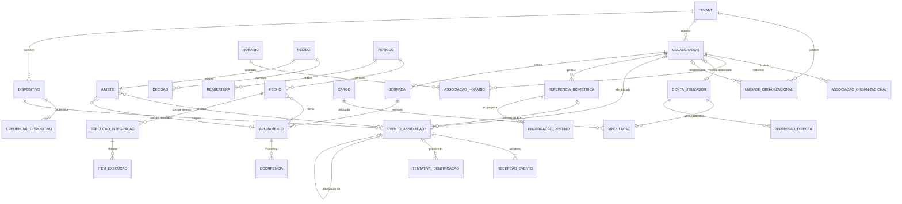

# Modelo de Dados — Sistema de Gestão de Assiduidade

## 1. Controlo do documento

| Campo | Valor |
| --- | --- |
| Referência | MD-ASS-001 |
| Versão | 0.3 |
| Data | 25/09/2026 |
| Estado | Rascunho técnico para validação |
| Responsáveis | Equipa técnica, com validação de RH, equipa ERP e responsável de dados — nomes a designar |
| Base documental | [Requisitos Funcionais §5 e §6](02-Requisitos-Funcionais.md), [Diagramas UML DG-CL-01 a DG-CL-04](06-Diagramas-UML.md), [TDD](08-Documento-de-Design-Tecnico-TDD.md) |

| Versão | Data | Alteração |
| --- | --- | --- |
| 0.1 | 25/09/2026 | Lista de entidades e campos de `attendance_event` |
| 0.2 | 25/09/2026 | Versão detalhada: catálogo completo, diagrama ER, dicionário das entidades críticas, estados alinhados com RF §6, integridade, retenção e lacunas do esquema existente |
| 0.3 | 25/09/2026 | Entidades de acesso alinhadas com permissões granulares: ENT-04 `cargo`, ENT-06 `vinculacao`, `permissao_directa` e `permissao_tipo`; responsável de unidade em ENT-02 como origem do âmbito hierárquico |

## 2. Objectivo, âmbito e convenções

Este documento transforma o modelo conceptual de DG-CL-01 a DG-CL-04 num modelo lógico relacional. Define entidades, campos obrigatórios, domínios de estado, restrições de integridade, temporalidade, índices e categorias de retenção. Não é um script de migração: tipos físicos e nomes finais dependem de DT-06 e DT-12.

Convenções:

- **ENT-xx** identifica entidades; **RI-xx** restrições de integridade; **CR-xx** categorias de retenção. Identificadores estáveis.
- **Nomes em português**, em `snake_case`, coerentes com o ERP existente (proposta de DT-12). A correspondência com os nomes conceptuais do documento 06 está na coluna "Classe DG".
- **Identificadores** (proposta de DT-06): `id` inteiro interno; `uuid` público exposto na API. O identificador de evento de assiduidade é sempre o UUID gerado na origem (MEC-03).
- **Tenant**: todas as tabelas de negócio têm `tenant_id` obrigatório, excepto os catálogos técnicos globais assinalados.
- **Tempo**: instantes em `timestamptz` (UTC); datas civis em `date`; vigências em intervalo semiaberto `[início, fim)`, com fim nulo para vigência aberta (MEC-04).
- **Tipos lógicos** usados nas tabelas: `id`, `uuid`, `texto`, `texto curto`, `inteiro`, `decimal`, `booleano`, `instante`, `data`, `duração`, `intervalo`, `enum`, `json`, `hash` (SHA-256 em hexadecimal).
- **Sem remoção física corrente.** Eventos, pedidos, decisões, ajustes, apuramentos, fechos e auditoria não têm operação de remoção. A eliminação de dados pessoais segue CMP-13 e a categoria de retenção (§8.4).

## 3. Catálogo de entidades

### 3.1. Organização, identidade e acessos (CMP-02, CMP-03)

| ID | Entidade | Classe DG | Finalidade | Proprietário |
| --- | --- | --- | --- | --- |
| ENT-01 | `tenant` | Tenant | Organização, fuso, idioma e estado | CMP-03 |
| ENT-02 | `unidade_organizacional` | UnidadeOrganizacional | Unidade, local, departamento ou equipa, com hierarquia e colaborador responsável (origem do âmbito hierárquico) | CMP-03 |
| ENT-03 | `conta_utilizador` | Utilizador | Conta de acesso ao backoffice ou app | CMP-02 |
| ENT-04 | `cargo` e `cargo_permissao` | Cargo | Conjunto de permissões `módulo:acção` composto por cada tenant | CMP-02 |
| ENT-05 | `permissao` | — | Catálogo global de códigos `módulo:acção` ([Requisitos Funcionais §3.2](02-Requisitos-Funcionais.md)) | CMP-02 (global) |
| ENT-06 | `vinculacao`, `permissao_directa` e `permissao_tipo` | Vinculacao, PermissaoDirecta | Vinculação da conta a um tenant com cargo e estado; permissões directas com autor e vigência; permissões por defeito de cada tipo de utilizador (catálogo global) | CMP-02 |
| ENT-07 | `autorizacao_suporte` | AutorizacaoSuporte | Acesso de suporte com finalidade, âmbito e validade | CMP-02 |
| ENT-08 | `colaborador` | Colaborador | Cadastro e estado do vínculo | CMP-03 |
| ENT-09 | `associacao_organizacional` | AssociacaoOrganizacional | Unidade, função e equipa com vigência | CMP-03 |
| ENT-10 | `designacao_aprovador` | DesignacaoAprovador | Aprovador designado, delegação ou escalonamento com vigência, que alarga o âmbito hierárquico dado pela responsabilidade de unidade | CMP-03 |
| ENT-11 | `credencial_identificacao` | CredencialIdentificacao | QR Code, NFC ou PIN associado a um colaborador | CMP-03 |

### 3.2. Horários e políticas (CMP-04)

| ID | Entidade | Classe DG | Finalidade |
| --- | --- | --- | --- |
| ENT-12 | `calendario` e `calendario_dia` | Calendario | Dias úteis, feriados e excepções por âmbito |
| ENT-13 | `horario` e `horario_periodo` | Horario | Horário fixo, flexível ou turno, com períodos de trabalho |
| ENT-14 | `associacao_horario` | AssociacaoHorario | Horário aplicável a colaborador ou grupo, com vigência |
| ENT-15 | `politica` e `politica_versao` | Politica | Parâmetros aprovados de tolerâncias, pausas, extraordinárias e arredondamento, versionados |

### 3.3. Terminais, marcações e biometria (CMP-05, CMP-06, CMP-07)

| ID | Entidade | Classe DG | Finalidade |
| --- | --- | --- | --- |
| ENT-16 | `dispositivo` | Terminal | Terminal ou dispositivo registado, com estado |
| ENT-17 | `credencial_dispositivo` | — | Credencial individual do dispositivo, rotativa e revogável (DT-05) |
| ENT-18 | `configuracao_versao` | VersaoConfiguracao | Versão publicada de métodos e política offline |
| ENT-19 | `propagacao_destino` | PropagacaoDestino | Estado por destino de configurações, revogações e alterações biométricas (MEC-11) |
| ENT-20 | `evento_assiduidade` | Marcacao | Evento central de entrada, saída ou pausa |
| ENT-21 | `recepcao_evento` | — | Cada recepção de um evento, incluindo reenvios e conteúdo divergente |
| ENT-22 | `tentativa_identificacao` | TentativaIdentificacao | Tentativas de identificação, com resultado, sem dados biométricos |
| ENT-23 | `habilitacao_biometrica` | HabilitacaoBiometrica | Habilitação, finalidade, consentimento quando aplicável e revogação |
| ENT-24 | `referencia_biometrica` | ReferenciaBiometrica | Metadados do template: versão, algoritmo, estado; o template está em CNT-09 |
| ENT-25 | `template_biometrico` | — | Conteúdo protegido do template, em armazenamento separado (CNT-09) |

### 3.4. Pedidos, apuramento e fecho (CMP-08, CMP-09, CMP-10)

| ID | Entidade | Classe DG | Finalidade |
| --- | --- | --- | --- |
| ENT-26 | `tipo_ausencia` | TipoAusencia | Tipos, unidade, documentos exigidos e origem do saldo |
| ENT-27 | `pedido` | Pedido | Supertipo de pedidos, com versão e estado |
| ENT-28 | `pedido_correccao` | PedidoCorreccao | Alvo, valor anterior e valor proposto |
| ENT-29 | `pedido_ausencia` | PedidoAusencia | Férias, ausências e justificações |
| ENT-30 | `pedido_cancelamento` | PedidoCancelamento | Cancelamento de pedido aprovado |
| ENT-31 | `anexo` | Anexo | Referência a ficheiro em CNT-08, com finalidade e âmbito |
| ENT-32 | `decisao` | Decisao | Decisão sobre uma versão de pedido |
| ENT-33 | `ajuste` | Ajuste | Alteração aprovada ligada a evento ou apuramento de origem |
| ENT-34 | `saldo` e `movimento_saldo` | Saldo | Saldos locais ou espelho de saldos externos, com movimentos |
| ENT-35 | `jornada` | Jornada | Instância de trabalho prevista, com data de referência |
| ENT-36 | `apuramento` | Apuramento | Versão do resultado de uma jornada ou período |
| ENT-37 | `ocorrencia` | Ocorrencia | Atrasos, faltas, extraordinárias e inconsistências com valores observado, elegível e aprovado |
| ENT-38 | `periodo` | Periodo | Intervalo de processamento com estado |
| ENT-39 | `fecho` | Fecho | Versão fechada de um período |
| ENT-40 | `reabertura` | Reabertura | Reabertura com motivo e autor |

### 3.5. Integração, auditoria e operação (CMP-12 a CMP-16)

| ID | Entidade | Classe DG | Finalidade |
| --- | --- | --- | --- |
| ENT-41 | `configuracao_integracao` | ConfiguracaoIntegracao | Destino, contrato, mapeamentos e referência à credencial |
| ENT-42 | `fonte_referencia` | FonteReferencia | Sistema de referência por entidade ou campo |
| ENT-43 | `execucao_integracao` | ExecucaoIntegracao | Operação de envio ou recepção com identidade estável |
| ENT-44 | `item_execucao` | ItemExecucao | Estado por item, confirmação externa e divergência |
| ENT-45 | `evento_auditoria` | EventoAuditoria | Evidência append-only com encadeamento |
| ENT-46 | `notificacao` | Notificacao | Envio por canal, estado e tentativas |
| ENT-47 | `politica_retencao` | PoliticaRetencao | Prazo por categoria e âmbito |
| ENT-48 | `operacao_ciclo_vida` e `destino_ciclo_vida` | OperacaoCicloVida, DestinoCicloVida | Eliminação/anonimização e acompanhamento por destino |
| ENT-49 | `chave_idempotencia` | — | Registo de MEC-02 |
| ENT-50 | `mensagem_saida` | — | Outbox transaccional de MEC-08 |

## 4. Diagrama entidade-relação

O diagrama mostra as relações principais; tabelas de apoio (catálogos, anexos, notificações) estão omitidas.

A ligação de `ajuste` a evento **ou** a apuramento resolve DU-10: exactamente uma das duas referências é preenchida (RI-11).

## 5. Dicionário das entidades críticas

As colunas comuns `id`, `uuid`, `tenant_id`, `criado_em` e `criado_por` existem em todas as tabelas de negócio e não são repetidas. Tabelas imutáveis não têm `actualizado_em`.

### 5.1. ENT-20 `evento_assiduidade` — imutável após criação, excepto estado e referências de resolução

| Campo | Tipo | Obrig. | Descrição | Origem |
| --- | --- | --- | --- | --- |
| `evento_uuid` | uuid | Sim | Identificador gerado na origem (MEC-03); único por tenant | RN-010 |
| `colaborador_id` | id | Não | Nulo enquanto for excepção de identidade (RN-008) | RF §5 |
| `tipo_evento` | enum | Sim | `entrada`, `saida`, `inicio_pausa`, `fim_pausa` | RF-021 |
| `origem` | enum | Sim | `terminal`, `app_colaborador`, `backoffice_assistido`, `importacao`, `api`, `ajuste` | BR-F-038 |
| `metodo_identificacao` | enum | Sim | `facial`, `impressao_digital`, `qr_code`, `nfc`, `pin`, `assistido` | RF-021, RF-027 a RF-030 |
| `dispositivo_id` | id | Cond. | Obrigatório quando a origem é terminal ou app | RF-019 |
| `instante_origem` | instante | Sim | Momento da captura em UTC | RN-013 |
| `fuso_origem` | texto curto | Sim | Fuso IANA do contexto (ex.: `Africa/Maputo`) | MEC-04 |
| `desvio_relogio_ms` | inteiro | Não | Desvio estimado do relógio do dispositivo | MEC-04 |
| `instante_recepcao` | instante | Sim | Primeira recepção central | RN-013 |
| `localizacao` | json | Cond. | Latitude, longitude, precisão e instante; só quando a política o exige | RF-031 |
| `referencia_biometrica_id` | id | Cond. | Versão do template usada; nunca o template | RF-035, RN-045 |
| `configuracao_versao_id` | id | Não | Versão de configuração aplicada no terminal | RF-020 |
| `estado` | enum | Sim | Ver §6.1 | RF §6 |
| `motivo_codigo` | texto curto | Cond. | Obrigatório em `rejeitado`, `pendente_analise` e `duplicado` | RF §5 |
| `motivo_texto` | texto | Não | Descrição para o analista | RF §5 |
| `duplicado_de_id` | id | Cond. | Obrigatório em `duplicado`; referencia o evento efectivo | RF §6 |
| `hash_conteudo` | hash | Sim | Hash canónico do conteúdo recebido (MEC-02) | RN-010 |
| `versao` | inteiro | Sim | Controlo de concorrência (MEC-07) | RNF-010 |

### 5.2. ENT-21 `recepcao_evento` — append-only

| Campo | Tipo | Obrig. | Descrição |
| --- | --- | --- | --- |
| `evento_id` | id | Sim | Evento a que a recepção corresponde |
| `instante_recepcao` | instante | Sim | Momento desta recepção |
| `canal` | enum | Sim | `online`, `sincronizacao`, `importacao` |
| `lote_uuid` | uuid | Não | Lote de sincronização, quando aplicável |
| `hash_conteudo` | hash | Sim | Hash do conteúdo desta recepção |
| `resultado` | enum | Sim | `primeira_recepcao`, `reenvio_equivalente`, `conteudo_divergente` |
| `conteudo_divergente` | json | Cond. | Conteúdo recebido quando diverge do original, para análise |

### 5.3. ENT-22 `tentativa_identificacao` — append-only

| Campo | Tipo | Obrig. | Descrição |
| --- | --- | --- | --- |
| `dispositivo_id` | id | Sim | Dispositivo onde ocorreu |
| `colaborador_id` | id | Não | Colaborador candidato, quando identificado |
| `metodo` | enum | Sim | Método tentado |
| `resultado` | enum | Sim | `sucesso`, `sem_correspondencia`, `prova_vida_falhada`, `qualidade_insuficiente`, `componente_indisponivel`, `credencial_invalida` |
| `instante` | instante | Sim | Momento da tentativa |
| `versao_algoritmo` | texto curto | Cond. | Obrigatório em tentativas biométricas |
| `configuracao_versao_id` | id | Não | Configuração aplicada |
| `evento_id` | id | Não | Evento resultante, quando houve |

Não contém imagens, templates nem pontuações brutas de correspondência (RF-037, PD-05).

### 5.4. ENT-27 `pedido` e subtipos

| Campo | Tipo | Obrig. | Descrição |
| --- | --- | --- | --- |
| `tipo_pedido` | enum | Sim | `correccao`, `ausencia`, `cancelamento` |
| `requerente_conta_id` | id | Sim | Quem submeteu |
| `colaborador_id` | id | Sim | Colaborador abrangido |
| `periodo_abrangido` | intervalo | Sim | Intervalo a que o pedido se refere |
| `motivo` | texto | Sim | Obrigatório (RF-046) |
| `estado` | enum | Sim | Ver §6.3 |
| `versao` | inteiro | Sim | Incrementada a cada alteração de conteúdo (MEC-07) |

`pedido_correccao`: `alvo_tipo` (`evento`, `jornada`, `apuramento`), `alvo_id`, `valor_anterior` (json, nulo em inclusão), `valor_proposto` (json). `pedido_ausencia`: `tipo_ausencia_id`, `unidade` (`dias`, `horas`, `fraccao`), `quantidade`. `pedido_cancelamento`: `pedido_cancelado_id`.

### 5.5. ENT-32 `decisao` e ENT-33 `ajuste`

| Entidade | Campo | Tipo | Descrição |
| --- | --- | --- | --- |
| `decisao` | `pedido_id`, `versao_pedido` | id, inteiro | Versão exacta decidida (RN-035) |
| | `decisor_conta_id` | id | Com competência verificada no momento (RN-031) |
| | `resultado` | enum | `aprovado`, `rejeitado` |
| | `motivo` | texto | Obrigatório na rejeição |
| | `instante` | instante | — |
| `ajuste` | `pedido_id` | id | Pedido de origem |
| | `evento_id` / `apuramento_id` | id | Exactamente um preenchido (RI-11) |
| | `antes`, `depois` | json | Valor anterior e novo |
| | `evento_gerado_id` | id | Evento de origem `ajuste` criado em inclusão de marcação |
| | `aplicado_em` | instante | Momento da aplicação |

### 5.6. ENT-35 a ENT-37 — jornada, apuramento e ocorrência

| Entidade | Campo | Tipo | Descrição |
| --- | --- | --- | --- |
| `jornada` | `colaborador_id`, `data_referencia` | id, data | Dia civil a que a jornada pertence (RN-017) |
| | `intervalo_previsto` | intervalo | Pode atravessar a meia-noite |
| | `horario_versao_id` | id | Horário aplicado |
| `apuramento` | `jornada_id` ou `periodo_id` | id | Âmbito do cálculo |
| | `numero_versao` | inteiro | Sequencial por âmbito |
| | `hash_entradas` | hash | `input_snapshot_hash` (MEC-06) |
| | `versoes_politica` | json | Identificadores das versões aplicadas |
| | `estado` | enum | `provisorio`, `pendente`, `fechado`, `substituido` |
| | `apuramento_anterior_id`, `motivo_recalculo` | id, texto | Ligação e motivo (RN-024) |
| | `tempo_presenca`, `tempo_liquido` | duração | Nulos quando indeterminados, nunca zero (RN §5.2) |
| `ocorrencia` | `tipo` | enum | `atraso`, `saida_antecipada`, `falta`, `pausa_excedida`, `extraordinaria_candidata`, `sequencia_incompleta`, `conflito_ausencia` |
| | `observado`, `elegivel`, `aprovado` | duração | Separação de RN-023 e RF-040 |

### 5.7. ENT-38 a ENT-40 — período, fecho e reabertura

| Entidade | Campo | Tipo | Descrição |
| --- | --- | --- | --- |
| `periodo` | `ambito_unidade_id`, `intervalo` | id, intervalo | Âmbito organizacional e datas |
| | `estado` | enum | Ver §6.4 |
| | `versao` | inteiro | MEC-07 |
| `fecho` | `periodo_id`, `numero_versao` | id, inteiro | Uma linha por fecho; nunca actualizada |
| | `autor_conta_id`, `instante` | id, instante | — |
| | `regras_aplicadas`, `excepcoes_justificadas` | json | Evidência de RF-049 |
| | `hash_resultados` | hash | Hash do conjunto de apuramentos fechados |
| | `fecho_anterior_id` | id | Versão N−1 |
| `reabertura` | `periodo_id`, `fecho_reaberto_id`, `motivo`, `autor_conta_id` | — | Evidência de RF-050 |

### 5.8. ENT-24 `referencia_biometrica` e ENT-19 `propagacao_destino`

| Entidade | Campo | Tipo | Descrição |
| --- | --- | --- | --- |
| `referencia_biometrica` | `colaborador_id`, `modalidade` | id, enum | `facial`, `impressao_digital` |
| | `identificador_protegido` | texto | Referência ao conteúdo em CNT-09 |
| | `versao_enrollment`, `versao_algoritmo` | texto curto | RF-033, RF-035 |
| | `operador_conta_id` | id | Quem executou o enrollment |
| | `estado` | enum | Ver §6.5 |
| | `substitui_id` | id | Referência anterior em substituição |
| `propagacao_destino` | `objecto_tipo`, `objecto_id` | enum, id | Configuração, referência biométrica ou revogação |
| | `destino_tipo`, `destino_id` | enum, id | Terminal ou sistema externo |
| | `operacao` | enum | `activar`, `suspender`, `eliminar`, `aplicar_configuracao`, `revogar` |
| | `estado` | enum | `pendente`, `confirmado`, `falhado` |
| | `confirmado_em`, `tentativas` | instante, inteiro | — |

### 5.9. ENT-43 `execucao_integracao` e ENT-44 `item_execucao`

| Campo | Tipo | Descrição |
| --- | --- | --- |
| `operacao_uuid` | uuid | Identidade estável; mantida em reprocessamento (RN-042) |
| `configuracao_integracao_id` | id | Destino e contrato |
| `direccao` | enum | `entrada`, `saida` |
| `objecto_tipo`, `objecto_id` | enum, id | Entidade mestre ou fecho enviado |
| `fecho_id` | id | Versão fechada enviada, quando aplicável |
| `estado` | enum | Ver §6.6 |
| `contagem_itens`, `totais`, `hash_lote` | inteiro, json, hash | Reconciliação (18 §4) |
| `item_execucao.estado` | enum | `pendente`, `confirmado`, `falhado`, `divergente` |
| `item_execucao.confirmacao_externa` | texto | Referência devolvida pelo destino |

### 5.10. ENT-45 `evento_auditoria` — append-only

| Campo | Tipo | Descrição |
| --- | --- | --- |
| `tenant_id` | id | Nulo apenas em operações globais da plataforma |
| `actor_tipo`, `actor_id` | enum, id | `utilizador`, `dispositivo`, `tarefa`, `integracao` |
| `accao`, `objecto_tipo`, `objecto_id` | texto curto, texto curto, id | Catálogo do [documento 16](16-Auditoria-e-Logs.md) |
| `resultado`, `motivo` | enum, texto | `sucesso`, `recusado`, `falhado` |
| `instante` | instante | Relógio do servidor |
| `correlacao_id`, `pedido_id` | uuid | MEC-12 |
| `origem_tecnica` | json | IP e dispositivo quando permitido |
| `hash_anterior`, `hash` | hash | Encadeamento (DT-07) |

### 5.11. ENT-49 `chave_idempotencia` e ENT-50 `mensagem_saida`

| Entidade | Campos | Regras |
| --- | --- | --- |
| `chave_idempotencia` | `tenant_id`, `ambito`, `chave`, `hash_pedido`, `estado`, `resposta`, `expira_em` | Único por `(tenant_id, ambito, chave)`; expiração superior à janela de reenvio (DN-03) |
| `mensagem_saida` | Campos do envelope de MEC-08, `estado`, `tentativas`, `proxima_tentativa_em`, `erro` | Gravada na mesma transacção do facto de negócio |

## 6. Domínios de estado

Os estados de negócio seguem RF §6 e DG-ES-01 a DG-ES-09. Estados técnicos (processamento em curso, tentativas) ficam em campos próprios (MEC-09).

### 6.1. Evento central (DG-ES-02)

| Estado | Significado | Transições de saída |
| --- | --- | --- |
| `recebido` | Registado, ainda sem decisão da tabela de recepção (RN §6.1) | `aceite`, `rejeitado`, `pendente_analise` |
| `aceite` | Disponível para apuramento | — |
| `rejeitado` | Recusado com motivo; preservado | — |
| `pendente_analise` | Conflito, autorização histórica, relógio suspeito, período fechado ou possível repetição | `aceite`, `rejeitado`, `duplicado` |
| `duplicado` | Evento distinto classificado como repetição de um evento efectivo; `duplicado_de_id` obrigatório | — |

**Interpretação adoptada, a confirmar em RF §6 (DU-02).** Um reenvio com o **mesmo** identificador não cria novo evento: fica registado em `recepcao_evento` com resultado `reenvio_equivalente` ou `conteudo_divergente` (RN-010). Conteúdo divergente cria uma pendência de análise ligada à recepção, sem alterar o evento original. O estado `duplicado` aplica-se apenas a eventos **distintos** considerados repetição (RN-011), por decisão autorizada ou por regra aprovada em PN-06. A legenda "mesmo identificador, conteúdo equivalente" da transição `Recebido → Duplicado` em DG-ES-02 deve ser corrigida no documento 06.

### 6.2. Evento local (DG-ES-01) — apenas no terminal

`pendente` → `enviado` → `confirmado`; `enviado` → `pendente_reenvio` → `enviado`. Estrutura no [documento 11 §6](11-Especificacao-de-Dispositivos-Terminais.md).

### 6.3. Pedido e cancelamento (DG-ES-03, DG-ES-04)

| Objecto | Estados |
| --- | --- |
| Pedido | `rascunho`, `submetido`, `em_aprovacao`, `aprovado`, `rejeitado`, `cancelado` |
| Cancelamento | `solicitado`, `aprovado`, `rejeitado` |

Devolução e desistência (RN-036) não têm estado próprio enquanto DU-03 não for resolvido.

### 6.4. Período (DG-ES-05)

`aberto`, `em_validacao`, `fechado`, `reaberto`. Cada passagem a `fechado` cria uma linha em `fecho`.

### 6.5. Referência biométrica (DG-ES-06)

`em_preparacao`, `activo`, `suspenso`, `substituido`, `eliminacao_pendente`, `eliminado`. O estado de distribuição por terminal está em `propagacao_destino`, não na referência. Reactivação de `suspenso` não é permitida enquanto DU-05 não for resolvido.

### 6.6. Execução de integração (DG-ES-07)

`pendente`, `em_processamento`, `confirmada`, `parcial`, `falhada`, `em_reprocessamento`.

### 6.7. Tenant, colaborador, dispositivo e conta

| Objecto | Estados | Origem |
| --- | --- | --- |
| Tenant | `criado`, `activo`, `suspenso`, `desactivado` | DG-ES-09 |
| Colaborador | `activo`, `suspenso`, `terminado` | DG-ES-09 |
| Dispositivo | `registado`, `activo`, `revogado` | DG-ES-08; `suspenso` e `retirado` propostos em [11 §4](11-Especificacao-de-Dispositivos-Terminais.md) |
| Conta | `convidada`, `activa`, `suspensa`, `bloqueada`, `terminada` | Proposta do [documento 14](14-Gestao-de-Utilizadores-e-Perfis.md), a incluir em RF §6 (DU-07) |

## 7. Regras de integridade

| ID | Restrição | Implementação proposta | Origem |
| --- | --- | --- | --- |
| RI-01 | Todas as referências entre tabelas de negócio pertencem ao mesmo tenant | Chaves estrangeiras compostas com `tenant_id` | RN-001, RF-004 |
| RI-02 | `evento_uuid` único por tenant | Índice único `(tenant_id, evento_uuid)` | RN-010 |
| RI-03 | Identificador de colaborador único por tenant | Índice único `(tenant_id, identificador_no_tenant)` | RN-003 |
| RI-04 | Hierarquia organizacional sem ciclos | Verificação na escrita e restrição de caminho | RF-004 |
| RI-05 | Vigências exclusivas sem sobreposição | Restrição de exclusão sobre intervalos por colaborador e tipo | MEC-05 |
| RI-06 | Tabelas append-only não aceitam actualização nem remoção | Permissões da conta da aplicação e trigger de recusa | PD-01, RNF-025 |
| RI-07 | `duplicado` exige `duplicado_de_id` e motivo; `rejeitado` e `pendente_analise` exigem motivo | Restrição de verificação | RF §5, RF §6 |
| RI-08 | Transições de estado apenas as de §6 | Tabela de transições aplicada no serviço e verificada por trigger | MEC-09 |
| RI-09 | Uma decisão efectiva por versão de pedido | Índice único parcial `(pedido_id, versao_pedido)` | RN-035 |
| RI-10 | Apuramento de período fechado não é alterado | Recusa de escrita quando o período está `fechado` | RN-038 |
| RI-11 | Ajuste referencia exactamente um alvo | Restrição: `evento_id` xor `apuramento_id` | DU-10 |
| RI-12 | Remoção de colaborador ou tenant não remove eventos | Chaves estrangeiras sem remoção em cascata | RN-004 |
| RI-13 | Uma versão de política activa por âmbito e vigência | Restrição de exclusão | RN-007 |
| RI-14 | Fecho nunca é actualizado | Append-only (RI-06) | PD-07 |

## 8. Temporalidade, índices, particionamento e retenção

### 8.1. Temporalidade

Associações (horário, organização, aprovadores, acessos) e políticas guardam vigência; consultas históricas usam a vigência no instante do evento (RN-006). Resultados guardam as versões aplicadas. Nenhuma alteração de vigência modifica resultados de períodos fechados (RF-010).

### 8.2. Índices mínimos

| Tabela | Índice | Finalidade |
| --- | --- | --- |
| `evento_assiduidade` | `(tenant_id, evento_uuid)` único | Idempotência |
| | `(tenant_id, colaborador_id, instante_origem)` | Apuramento e histórico |
| | `(tenant_id, estado)` parcial para `pendente_analise` | Filas de análise |
| `recepcao_evento` | `(tenant_id, lote_uuid)` | Reconciliação de lotes |
| `apuramento` | `(tenant_id, jornada_id, numero_versao)` único | Versões |
| `pedido` | `(tenant_id, estado, colaborador_id)` | Pendências |
| `propagacao_destino` | `(tenant_id, destino_id, estado)` | Distribuição a terminais |
| `evento_auditoria` | `(tenant_id, instante)`, `(tenant_id, objecto_tipo, objecto_id)` | Consulta de auditoria |
| `mensagem_saida` | `(estado, proxima_tentativa_em)` | Entrega |

### 8.3. Particionamento

Com volume elevado (DN-01), `evento_assiduidade`, `recepcao_evento`, `tentativa_identificacao` e `evento_auditoria` são particionadas por mês de instante, com `tenant_id` como primeira coluna dos índices. A retenção por partição só é aplicada quando toda a partição está elegível (§8.4). Relatórios usam projecções ou réplica (DT-11).

### 8.4. Categorias de retenção

Os prazos dependem de DF-08, DN-06 e PN-12; nenhum valor está aprovado.

| ID | Categoria | Entidades | Tratamento no fim do prazo |
| --- | --- | --- | --- |
| CR-01 | Eventos e tentativas | ENT-20 a ENT-22 | Anonimização ou eliminação por partição |
| CR-02 | Resultados fechados | ENT-35 a ENT-40 | Conservação pelo prazo legal/contratual aprovado |
| CR-03 | Pedidos e anexos | ENT-27 a ENT-33, ficheiros em CNT-08 | Eliminação de anexos; conservação mínima da decisão |
| CR-04 | Dados biométricos | ENT-23 a ENT-25 | Eliminação com confirmação por destino (MEC-11) |
| CR-05 | Auditoria | ENT-45 | Conservação pelo prazo de auditoria aprovado |
| CR-06 | Logs técnicos e telemetria | CNT-12 | Expiração automática |
| CR-07 | Cópias de segurança | Todas | Expiração controlada e reaplicação de eliminações no restauro (RN-048) |

## 9. Situação actual e lacunas

Esquema observado em 25/09/2026 (migração `20260724080001_baseline_schema` e seguintes). Serve de ponto de partida para DT-01 e para o [Plano de Migração](28-Plano-de-Migracao-de-Dados.md); não é requisito.

| Entidade | Tabela existente | Lacunas face a este modelo |
| --- | --- | --- |
| ENT-20 | `rh.eventos_assiduidade` | Sem identificador gerado na origem nem restrição de idempotência; sem instante de recepção distinto de `created_at`; `estado` mistura estado de recepção com classificação do apuramento (`fora_horario`, `incompleto`, `corrigido`); tem `updated_at`, o que admite alteração; `foto_url` permite conservar imagens, contra PD-05 |
| ENT-21 | — | Não existe registo de recepções e reenvios |
| ENT-28, ENT-33 | `rh.correcoes_evento`, `rh.pedidos_correcao_ponto` (modelo antigo) | Pedido e ajuste na mesma linha; sem versão de pedido; dois modelos em paralelo |
| ENT-29 | `rh.ausencias`, `rh.justificacoes` | Dois modelos de pedido; sem versão |
| ENT-36 | `rh.resultados_periodos`, `rh.marcacoes_interpretadas` | Sem versões nem hash de entradas; resultado actualizado no lugar |
| ENT-38 a ENT-40 | `rh.periodos_avaliacao` (estados `aberto`, `encerrado`) | Sem fechos versionados nem reaberturas; confirmar se a tabela se refere a assiduidade |
| ENT-16, ENT-17 | `hardware.devices`, `hardware.device_configs` | Autenticação por chave de API; ver DT-05 |
| ENT-24, ENT-25 | `hardware.fingerprint_templates`, `rh.facial_verification_uses` | Inventariar localização e protecção dos templates faciais |
| ENT-23 | `lgpd.consentimentos` | Verificar ligação à habilitação por finalidade e revogação |
| ENT-45 | `rh.auditoria_assiduidade` | Sem encadeamento nem protecção contra alteração |
| Legado | `rh.presencas` | Modelo por dia com horas em texto; manter só enquanto decorrer a migração |
| Integridade | `rh.marcacoes_interpretadas` com `ON DELETE CASCADE` sobre funcionários e eventos | Remoção em cascata contraria RI-12 |

O endpoint `DELETE /api/rh/funcionarios/{id}/presencas/{presencaId}` do [inventário](../endpoints_assiduidade_erp.md) é uma remoção física contrária a PD-01; ver [10 §9](10-Especificacao-de-APIs.md).

## 10. Rastreabilidade

| Entidades | Classes DG | Requisitos | Regras |
| --- | --- | --- | --- |
| ENT-01 a ENT-11 | DG-CL-01 | RF-001 a RF-013 | RN-001 a RN-005, RN-032 |
| ENT-12 a ENT-15 | DG-CL-03 | RF-014 a RF-018 | RN-006, RN-007 |
| ENT-16 a ENT-25 | DG-CL-02 | RF-019 a RF-037, RF-061 | RN-008 a RN-016, RN-043 a RN-045 |
| ENT-26 a ENT-40 | DG-CL-03 | RF-038 a RF-050 | RN-017 a RN-039 |
| ENT-41 a ENT-50 | DG-CL-04 | RF-054, RF-056 a RF-062 | RN-040 a RN-042, RN-047 |
| RI-01 a RI-14 | DG-ES-01 a DG-ES-09 | RF §6 | RN-010, RN-035, RN-038 |
| §8.4 | DG-AC-04 | RF-062 | RN-047, RN-048 |

## 11. Decisões pendentes

| Decisão | Efeito neste modelo |
| --- | --- |
| DT-01 | Evolução das tabelas de §9 ou migração para novas tabelas |
| DT-04 | Aplicação de Row-Level Security sobre `tenant_id` |
| DT-06 | Tipos de `id` e `uuid` |
| DT-07 | Implementação física de ENT-45 |
| DT-08, DT-11 | Persistência de versões e projecções de leitura |
| DT-12 | Nomes finais de tabelas e colunas |
| DU-02, DU-03, DU-05, DU-07, DU-10 | Estados e ligações de §6 e RI-11 |
| DF-08, DN-06, PN-12 | Prazos das categorias CR-01 a CR-07 |
| PN-06 | Classificação automática de `duplicado` |

## 12. Aprovação e referências

A equipa técnica valida estrutura, tipos e integridade; RH valida jornada, apuramento, ocorrência e pedidos; a equipa ERP valida integração e fontes de referência; o responsável de dados valida biometria e retenção. Cada aprovação deve identificar nome, versão e data. Estado de aprovação desta versão: **pendente**.

- [Índice da documentação](README.MD).
- [Diagramas UML](06-Diagramas-UML.md), secções 5 e 8.
- [TDD](08-Documento-de-Design-Tecnico-TDD.md), [Arquitectura](07-Arquitectura-do-Sistema.md), [APIs](10-Especificacao-de-APIs.md).
