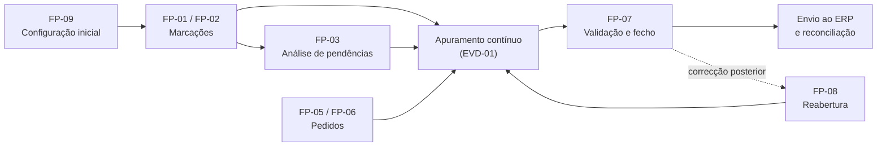

# Fluxos de Processos — Sistema de Gestão de Assiduidade

## 1. Controlo do documento

| Campo | Valor |
| --- | --- |
| Referência | FLX-ASS-001 |
| Versão | 0.3 |
| Data | 25/09/2026 |
| Estado | Rascunho técnico para validação |
| Responsáveis | Equipa técnica e RH, com validação da equipa ERP, operação e responsável de dados — nomes a designar |
| Base documental | [Casos de Uso](05-Casos-de-Uso.md), [Diagramas UML](06-Diagramas-UML.md) §6 e §7, [Arquitectura](07-Arquitectura-do-Sistema.md), [APIs](10-Especificacao-de-APIs.md) |

| Versão | Data | Alteração |
| --- | --- | --- |
| 0.1 | 25/09/2026 | Cinco fluxos em resumo |
| 0.2 | 25/09/2026 | Versão detalhada: ciclo de assiduidade, doze fluxos com componentes, endpoints, eventos, excepções e controlos; correcção do tratamento da fila offline |
| 0.3 | 25/09/2026 | Executores descritos pela permissão `módulo:acção` exigida em vez de perfis PRF; FP-09 activa o tenant antes dos cenários de validação (ACH-39) |

## 2. Objectivo, âmbito e convenções

Os [Casos de Uso](05-Casos-de-Uso.md) descrevem o que cada actor faz e obtém; os diagramas de sequência do [documento 06](06-Diagramas-UML.md) mostram as interacções lógicas. Este documento descreve **como o sistema executa** cada processo: que componentes (CMP) actuam, que endpoints (EP) e eventos de domínio (EVD) são usados, que estados mudam e que controlos se aplicam. Em caso de divergência, prevalecem os casos de uso.

Convenções: **FP-xx** identifica fluxos. Cada fluxo indica gatilho, passos, resultado, excepções e controlos.

## 3. Ciclo de assiduidade

| Momento | Processos | Responsável |
| --- | --- | --- |
| Diariamente | FP-01, FP-02, apuramento automático, FP-03 | Colaboradores, sistema, RH |
| Durante o período | FP-05, FP-06, decisões | Colaboradores, chefias, RH |
| Fim do período | FP-07 | RH |
| Após o fecho | Envio e reconciliação; FP-08 quando necessário | Sistema, equipa ERP, RH |
| Periodicamente | FP-10, FP-11, exercícios de FP-12 | RH, responsável de dados, operação |

## 4. Fluxos

### 4.1. FP-01 — Marcação online

**Gatilho:** colaborador inicia marcação num terminal ou na aplicação. **Caso de uso:** UC-01. **Diagramas:** DG-SQ-01, DG-AC-01.

1. O terminal verifica estado, versão de configuração e credencial (DSP-23, DSP-28).
2. O colaborador escolhe o tipo de evento; o terminal apresenta o método activo para o local.
3. O método identifica o colaborador; na modalidade facial, prova de vida e comparação (BIO-11, BIO-12). Tentativas falhadas são registadas (EP-036).
4. O terminal gera `evento_uuid`, regista instante, fuso, desvio de relógio e, se exigida, localização (MEC-03, MEC-04).
5. O terminal envia o evento (EP-031); CMP-01 autentica o dispositivo e resolve o contexto (MEC-01).
6. CMP-06 aplica a tabela de recepção (RN §6.1): idempotência, habilitação, vigência, relógio, período, sequência.
7. CMP-06 grava o evento e a recepção; se aceite, publica EVD-01; se em pendência, EVD-02.
8. O terminal mostra "aceite centralmente", "registado com pendência" ou "rejeitado", com instrução.
9. CMP-09 consome EVD-01 e recalcula a jornada (MEC-06).

**Excepções:** sem ligação no passo 5 → FP-02; falha de identificação → alternativa ou pedido assistido (DSP-21), sem falta automática; reenvio → resultado original (EP-031, 200); dispositivo revogado → `DISPOSITIVO_REVOGADO`.
**Controlos:** PD-03, MEC-02, RN-008 a RN-016, RN-044.

### 4.2. FP-02 — Marcação offline e sincronização

**Gatilho:** marcação sem ligação ao serviço central. **Caso de uso:** UC-06. **Diagramas:** DG-SQ-02, DG-ES-01.

1. O terminal valida a autorização offline e o espaço disponível (DSP-16).
2. Grava o evento cifrado na fila, de forma transaccional, e só então mostra "guardado localmente, pendente de sincronização" (DSP-11).
3. Ao recuperar a ligação, troca referência temporal com o servidor (EP-027, DSP-18).
4. Envia lotes pela ordem de captura (EP-032), com os identificadores originais.
5. A API processa cada item como em FP-01, passos 6 e 7, e responde por item.
6. O terminal retira da fila **todos os itens com resultado individual** — aceites, rejeitados ou em pendência — e mantém apenas os que tiveram erro técnico ou ficaram sem resposta (DSP-14).
7. Itens mantidos são reenviados com backoff e o mesmo identificador.

**Excepções:** autorização offline expirada → contingência e item devolvido com `AUTORIZACAO_OFFLINE_EXPIRADA`; fila cheia → falha explícita, sem descarte; evento capturado antes de revogação → pendência `AUTORIZACAO_HISTORICA` (RN-015).
**Controlos:** RN-013, RN-014, RNF-007, RNF-008, MEC-02.

A versão 0.1 indicava que o terminal mantinha "conflitos e falhas na fila para intervenção". Isso impediria o esvaziamento da fila e contrariava RN-014: conflitos e rejeições passam a ser tratados no backoffice (FP-03).

### 4.3. FP-03 — Análise de eventos pendentes

**Gatilho:** evento em `pendente_analise` (EVD-02) ou recepção com conteúdo divergente. **Casos de uso:** UC-01, UC-13.

1. RH consulta a fila de pendências por motivo (EP-035), limitada ao seu âmbito.
2. Para cada evento, vê o conteúdo, as recepções, as tentativas de identificação e a jornada afectada.
3. Decide: aceitar, rejeitar com motivo ou classificar como duplicado de um evento efectivo (RN-011).
4. CMP-06 aplica a transição (MEC-09), regista EVA-13 e, se aceite, publica EVD-01.
5. Se o evento pertence a período fechado, a aceitação fica condicionada a FP-08 (RN-016).

**Controlos:** PERM-13, RN-011, RN-015, RN-016, PD-09 (sem classificação automática enquanto PN-06 não estiver aprovado).

### 4.4. FP-04 — Enrollment e ciclo de vida biométrico

**Gatilho:** habilitação inicial, substituição, suspensão ou eliminação. **Casos de uso:** UC-04, UC-12. **Diagramas:** DG-SQ-04, DG-SQ-07, DG-ES-06.

1. Um utilizador com `assiduidade:gerir_habilitacao_biometrica` regista a habilitação do colaborador para a modalidade (EP-037, BIO-01).
2. Um utilizador com `assiduidade:gerir_biometria` inicia o enrollment (EP-038); CMP-07 verifica a habilitação e a segregação (SDF-05).
3. Capturas guiadas com qualidade e prova de vida até sucesso ou desistência.
4. Conclusão cria a referência `activo`, liga-a à anterior em substituição e publica EVD-06.
5. CMP-05 cria registos de propagação por destino (MEC-11); os terminais obtêm e confirmam (EP-028, EP-029).
6. Suspensão ou eliminação (EP-039) seguem os passos 4 e 5 com a operação correspondente; a eliminação só passa a `eliminado` com todos os destinos confirmados (BIO-22).

**Excepções:** sem habilitação → procedimento alternativo, sem recolha; captura incompleta → nenhuma referência activa; destino offline → pendente, sujeito à validade offline.

### 4.5. FP-05 — Pedido de correcção

**Gatilho:** marcação em falta ou resultado incorrecto. **Caso de uso:** UC-02. **Diagramas:** DG-SQ-03.

1. O requerente cria o pedido (EP-043) com alvo, valor proposto e motivo; o original não é alterado.
2. Submete (EP-048); CMP-08 encaminha ao aprovador designado (ENT-10) e publica notificação (INT-18).
3. O aprovador decide sobre a versão (EP-049, `If-Match`); CMP-08 verifica a permissão de decisão, o âmbito sobre o colaborador e a segregação sobre as pessoas envolvidas (SDF-02, SDF-03).
4. Aprovação cria o ajuste (ENT-33) e publica EVD-03; CMP-09 recalcula o âmbito afectado.
5. Rejeição regista motivo e não produz efeitos.

**Excepções:** período fechado → o pedido pode ser submetido e decidido, mas o ajuste só é aplicado após FP-08 (UC-02; a recusa na submissão em DG-SQ-03 deve ser alinhada com UC-02); alteração do pedido em aprovação → nova versão e nova decisão (DU-04); decisão concorrente → `CONFLITO_VERSAO`.
**Controlos:** RN-031 a RN-036, MEC-07.

### 4.6. FP-06 — Pedido de férias, ausência ou justificação

**Gatilho:** necessidade de ausência ou de justificar falta/atraso. **Caso de uso:** UC-14. **Diagramas:** DG-AC-03.

1. O requerente escolhe o tipo, o intervalo, a unidade e anexa documentos exigidos (EP-044, EP-050).
2. CMP-08 valida datas, documentos, sobreposições e saldo na fonte de referência (RN-025, RN-027, RN-028).
3. Encaminha ao aprovador; decisão como em FP-05, passo 3.
4. Aprovação aplica os efeitos autorizados ao apuramento (EVD-03) e ao saldo, uma única vez; se o saldo for externo, envia o movimento pela integração (INT-01).
5. Cancelamento posterior (EP-045) reverte os efeitos uma vez (RN-030).

**Excepções:** saldo não fiável → sem aprovação automática; período fechado → efeitos aplicados após FP-08.

### 4.7. FP-07 — Validação, fecho e envio ao ERP

**Gatilho:** fim do período. **Casos de uso:** UC-03, UC-05. **Diagramas:** DG-SQ-05, DG-ES-05, DG-ES-07.

1. RH inicia a validação (EP-058); o período passa a `em_validacao`.
2. CMP-10 recolhe pendências de CMP-06, CMP-08, CMP-09 e CMP-12, marcando as impeditivas (PN-09).
3. RH resolve pendências ou justifica excepções permitidas.
4. RH confirma o fecho (EP-059, `If-Match`); CMP-10 verifica que o conjunto validado não mudou.
5. CMP-10 cria o fecho (versão, hash dos resultados, regras), regista EVA-20 e publica EVD-04.
6. CMP-12 cria a execução de envio (INT-06), envia os itens e regista confirmações.
7. CMP-12 reconcilia contagens e totais (INT-12); falhas parciais seguem reprocessamento (INT-09).

**Excepções:** pendência impeditiva → `PENDENCIAS_IMPEDITIVAS`; conjunto alterado → nova validação; timeout do ERP → consulta antes de reenviar (INT-08); evento tardio → FP-03, sem alterar o fecho.

### 4.8. FP-08 — Reabertura e novo fecho

**Gatilho:** correcção necessária sobre período fechado. **Caso de uso:** UC-15. **Diagramas:** DG-SQ-06.

1. Um utilizador com `assiduidade:reabrir_periodo` (PERM-24) e autenticação reforçada pede a reabertura com motivo (EP-060).
2. CMP-10 preserva o fecho N, passa o período a `reaberto`, regista EVA-20 e publica EVD-05.
3. CMP-12 marca os envios da versão N como pendentes de reconciliação.
4. Ajustes e eventos pendentes são aplicados; CMP-09 recalcula.
5. Segue FP-07, produzindo a versão N+1, enviada como substituição ou ajuste (INT-10).

**Excepções:** destino sem suporte a revisões → pendência explícita (INT-11).

### 4.9. FP-09 — Configuração inicial de um tenant

**Gatilho:** novo cliente ou nova organização. **Casos de uso:** UC-07 a UC-11, UC-19.

1. A administração da plataforma (tipo `superadmin`) cria o tenant e a conta de administração inicial (EP-010, TEN-08).
2. Um utilizador com `sistema-configuracao:editar_configuracoes` configura fuso, idioma e estrutura (EP-011, EP-012); com `autorizacao:gerir_perfis` e `autorizacao:gerir_utilizadores` compõe os cargos do tenant a partir do catálogo de permissões e cria as contas (EP-006 a EP-008).
3. Um utilizador com `assiduidade:gerir_integracao` configura e testa a integração de dados mestre (EP-065, EP-066), ou um utilizador com `recursos-humanos:importar_funcionarios` importa colaboradores (EP-016).
4. Um utilizador com `recursos-humanos:gerir_horarios` e `assiduidade:gerir_configuracao` configura calendários, horários e políticas; quem tem `assiduidade:activar_politica` activa as versões aprovadas (EP-017 a EP-021).
5. Um utilizador com `hardware:gerir_dispositivos` regista terminais, emite credenciais e publica configuração (EP-023 a EP-026).
6. São registadas as habilitações biométricas e executados os enrollments (FP-04).
7. A administração da plataforma activa o tenant (TEN-08: um tenant `criado` não aceita marcações).
8. Execução dos cenários de validação: marcação online e offline, correcção, apuramento, fecho de teste. O tenant só é disponibilizado aos colaboradores depois de estes cenários serem aprovados.

**Controlos:** PD-09 (sem parâmetros presumidos), TEN-08.

### 4.10. FP-10 — Relatórios e exportação

**Gatilho:** consulta, exportação ou agendamento. **Caso de uso:** UC-16.

1. O actor escolhe relatório e filtros (EP-062); CMP-11 limita o âmbito e indica se os resultados são provisórios ou fechados.
2. Relatórios pesados e exportações (EP-063) executam em CNT-05 sobre projecções de leitura (DT-11).
3. A exportação exige finalidade e campos; EVA-21 é gravado antes da entrega.
4. Agendamentos (EP-064) revalidam permissões e destinatários em cada execução (CA-09).

**Excepções:** falha de geração não disponibiliza ficheiro parcial; biometria nunca é incluída (RN-046).

### 4.11. FP-11 — Retenção e eliminação

**Gatilho:** expiração da retenção ou pedido validado. **Caso de uso:** UC-18. **Diagramas:** DG-AC-04.

1. Uma tarefa de CMP-13 identifica dados elegíveis por categoria (CR-01 a CR-07).
2. Verifica impedimentos formalmente registados.
3. Cria operações por destino (base, ficheiros, caches, terminais, cópias) e executa-as de forma idempotente.
4. Acompanha confirmações; destinos offline ficam pendentes; cópias seguem expiração controlada.
5. Regista EVA-24 com a conclusão, sem conservar o conteúdo eliminado.

### 4.12. FP-12 — Recuperação de serviço

**Gatilho:** incidente ou exercício. **Caso de uso:** UC-21. **Diagramas:** DG-AC-05.

1. A operação declara o incidente e congela operações sensíveis.
2. Selecciona o ponto de recuperação e restaura pela ordem de [Arquitectura §10](07-Arquitectura-do-Sistema.md).
3. Reaplica as decisões posteriores à cópia (SEG-28).
4. Reconcilia eventos, filas locais dos terminais, fechos, auditoria e integrações.
5. Valida isolamento e percursos críticos, mede RPO e RTO e autoriza a retoma (SEG-29, SEG-30).

## 5. Rastreabilidade

| Fluxo | Casos de uso | Diagramas | Requisitos |
| --- | --- | --- | --- |
| FP-01 | UC-01 | DG-SQ-01, DG-AC-01 | RF-021 a RF-024, RF-027 a RF-035 |
| FP-02 | UC-06 | DG-SQ-02, DG-ES-01 | RF-025, RF-026 |
| FP-03 | UC-01, UC-13 | DG-ES-02 | RF-024 |
| FP-04 | UC-04, UC-12 | DG-SQ-04, DG-SQ-07, DG-ES-06 | RF-032 a RF-037, RF-061 |
| FP-05 | UC-02 | DG-SQ-03 | RF-046, RF-047 |
| FP-06 | UC-14 | DG-AC-03 | RF-041 a RF-045 |
| FP-07 | UC-03, UC-05 | DG-SQ-05, DG-ES-05, DG-ES-07 | RF-048, RF-049, RF-058, RF-059 |
| FP-08 | UC-15 | DG-SQ-06 | RF-050 |
| FP-09 | UC-07 a UC-11, UC-19 | DG-UC-04 | RF-001 a RF-020, RF-056 |
| FP-10 | UC-16 | — | RF-051 a RF-055 |
| FP-11 | UC-18 | DG-AC-04 | RF-062 |
| FP-12 | UC-21 | DG-AC-05 | RF-065 |

## 6. Pontos a alinhar na origem

| Ponto | Situação | Documento a actualizar |
| --- | --- | --- |
| Correcção sobre período fechado | UC-02 permite submeter e aplica só após reabertura; DG-SQ-03 recusa na submissão. FP-05 segue UC-02 | 06, DG-SQ-03 |
| Semântica de "duplicado" | FP-03 e [09 §6.1](09-Modelo-de-Dados.md) reservam `duplicado` para eventos distintos; DG-ES-02 usa-o para reenvios | 02 §6, 06 DG-ES-02 (DU-02) |

## 7. Aprovação e referências

RH valida FP-03, FP-05 a FP-08 e FP-10; a equipa técnica valida FP-01, FP-02 e FP-12; a equipa ERP valida FP-07 e FP-08; o responsável de dados valida FP-04 e FP-11. Cada aprovação deve identificar nome, versão e data. Estado de aprovação desta versão: **pendente**.

- [Índice da documentação](README.MD).
- [Casos de Uso](05-Casos-de-Uso.md), [Diagramas UML](06-Diagramas-UML.md), [Arquitectura](07-Arquitectura-do-Sistema.md), [APIs](10-Especificacao-de-APIs.md), [Integrações](18-Integracoes-com-Sistemas-Externos.md).
