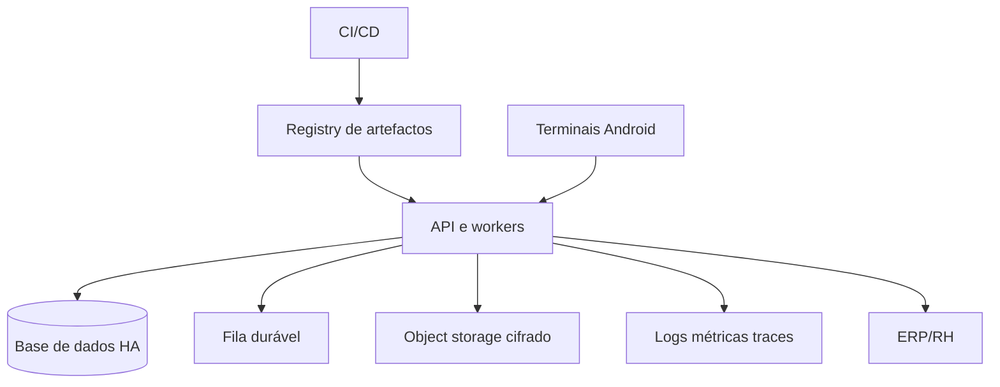

# 22. Deployment e Infraestrutura

**Referência:** DEP-ASS-001  
**Versão:** 0.1  
**Data:** 25/09/2026  
**Autor:** Manus AI

> **Estado:** Rascunho para validação. Este documento complementa os documentos 7 a 19 da série e deve ser aprovado pelos responsáveis indicados antes do piloto ou da entrada em produção.

## Arquitectura de deployment
A solução deve separar desenvolvimento, validação e produção. Em produção, API e workers executam em múltiplas instâncias; a base de dados, fila e armazenamento devem possuir mecanismos de redundância adequados à classe de serviço.

## Entrega
O pipeline deve executar lint, testes, análise de dependências, SAST, construção reprodutível, migrações verificadas e promoção por ambiente. Segredos são injectados pelo gestor de segredos e nunca ficam no repositório ou nos artefactos.

## Operação de infraestrutura
Devem existir health checks técnicos e de negócio, métricas de filas, latência, erro, capacidade, terminais e integrações. Backups devem ser cifrados, testados e sujeitos a retenção. Mudanças de esquema devem ser compatíveis com versões em execução durante o rollout.

## Rollback e configuração
Cada release deve possuir artefacto imutável, plano de rollback e migração reversível ou procedimento de restauração. Configurações por tenant são versionadas, auditadas e distribuídas aos terminais com confirmação.
## Documentos relacionados

Consultar os documentos 7 a 19 da série e o índice geral para arquitectura, requisitos, dados, APIs, segurança, integrações e fluxos de processos.
